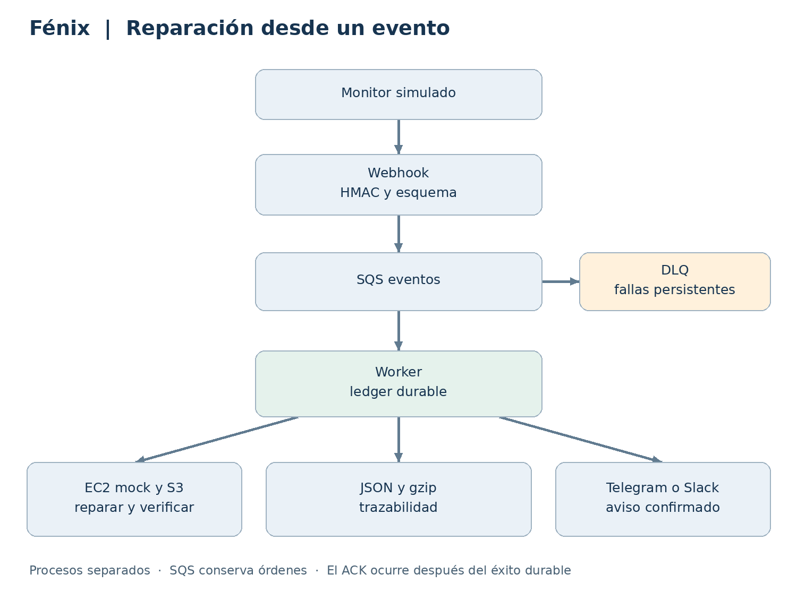
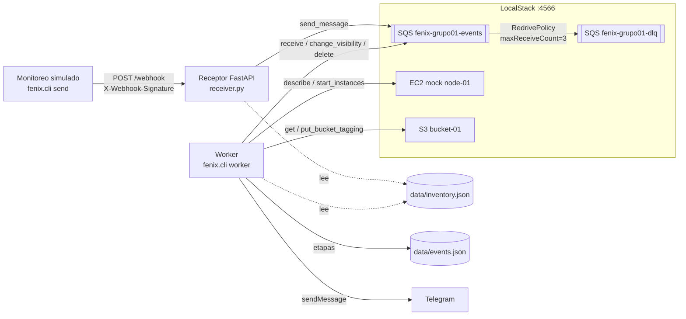
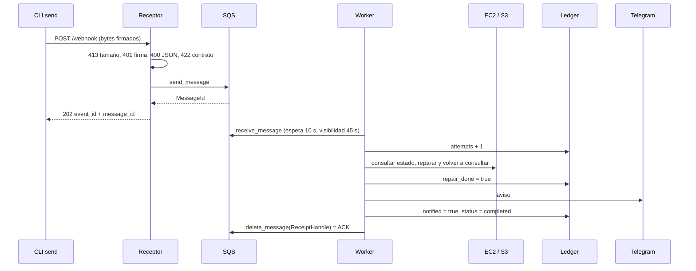

# 🔥 Proyecto Fénix — Sistema de Autorreparación de Infraestructura

**TP Final — Programación para Automatización II (PPA2)**

Link de defensa en YouTube: https://www.youtube.com/watch?v=ojaDcjFT7wA

Sistema de autorreparación de infraestructura cloud emulada que detecta desviaciones en recursos EC2 y S3, las corrige de forma convergente y notifica el resultado. Toda la operación se ejecuta contra **LocalStack** (emulador local de AWS) sin credenciales ni recursos reales.

## Índice

- [Arquitectura](#arquitectura) · [Requisitos Previos](#requisitos-previos) · [Instalación y Despliegue](#instalación-y-despliegue) · [Uso de la CLI](#uso-de-la-cli) · [Eventos de Ejemplo](#eventos-de-ejemplo) · [Ejecución de Tests](#ejecución-de-tests) · [Estructura del Proyecto](#estructura-del-proyecto)
- [Módulos por Integrante](#módulos-por-integrante) · [Matriz de Pruebas y Evidencias de Validación](#matriz-de-pruebas-y-evidencias-de-validación) · [Restricciones Técnicas del TP](#restricciones-técnicas-del-tp) · [Distribución de roles](#distribución-de-roles) · [Integrante 4: logging estructurado](#integrante-4-logging-estructurado)
- [Integrantes, módulos y pruebas](#integrantes-módulos-y-pruebas) · [Diagramas del flujo](#diagramas-del-flujo) · [Versiones verificadas y notas de instalación](#versiones-verificadas-y-notas-de-instalación) · [Variables de entorno](#variables-de-entorno) · [Contratos de entrada y salida](#contratos-de-entrada-y-salida)
- [Demostración completa por terminal](#demostración-completa-por-terminal) · [Reintentos y DLQ](#reintentos-y-dlq) · [Decisiones de idempotencia](#decisiones-de-idempotencia) · [Matriz de pruebas F01–F16](#matriz-de-pruebas-f01f16) · [Evidencias de la corrida integral](#evidencias-de-la-corrida-integral)
- [Canal de aviso elegido: Telegram](#canal-de-aviso-elegido-telegram) · [Limitaciones](#limitaciones) · [Limpieza del laboratorio](#limpieza-del-laboratorio) · [Video de defensa](#video-de-defensa) · [Registro de reproducción desde cero](#registro-de-reproducción-desde-cero)

---

## Arquitectura

```
┌──────────────┐    HMAC-SHA256     ┌──────────────────┐    SQS     ┌──────────────┐
│  CLI send    │ ──────────────────►│  Receptor HTTP   │ ─────────► │  Cola SQS    │
│  (firma +    │   POST /webhook    │  (FastAPI/Uvicorn)│  publish   │  events      │
│   evento)    │                    │  verify → validate│           │              │
└──────────────┘                    │  → enqueue (202) │           └──────┬───────┘
                                    └──────────────────┘                  │ receive
                                                                         ▼
┌──────────────┐    Telegram/       ┌──────────────────┐          ┌──────────────┐
│  Canal de    │ ◄──────────────────│  Remediación     │ ◄────────│   Worker     │
│  Notificación│    console         │  (repair + notify)│  handler │  (1 msg/vez) │
└──────────────┘                    │  ledger durable  │          │  ACK/retry   │
                                    └──────────────────┘          └──────────────┘
                                           │                             │
                                           ▼                             │ backoff
                                    ┌──────────────┐              ┌──────────────┐
                                    │ EC2 / S3     │              │   DLQ        │
                                    │ (LocalStack) │              │  (maxReceive │
                                    └──────────────┘              │   Count = 3) │
                                                                  └──────────────┘
```

**Flujo principal:**

1. `CLI send` firma un evento JSON con HMAC-SHA256 y lo envía vía HTTP al receptor.
2. El **receptor FastAPI** verifica la firma, valida el evento contra el inventario y lo encola en SQS (respuesta `202 Accepted`).
3. El **worker** consume mensajes de la cola uno a uno con long polling (10 s).
4. El **handler de remediación** revalida el evento, repara el recurso (arranca EC2 o restaura tags de S3) y notifica por Telegram/consola, registrando cada etapa en un ledger durable (`data/events.json`).
5. Solo tras el éxito durable del handler se ejecuta el ACK (delete del mensaje). Ante fallas, se aplica **backoff exponencial** vía `change_message_visibility`. Tras 3 recepciones fallidas, SQS aísla el mensaje en la **DLQ**.

---

## Requisitos Previos

| Requisito               | Versión mínima                                             |
| ----------------------- | ---------------------------------------------------------- |
| Python                  | 3.11+                                                      |
| Docker + Docker Compose | Para ejecutar LocalStack                                   |
| LocalStack              | Imagen `localstack/localstack:4.14.0` (definida en `.env`) |

### Dependencias Python

Declaradas en [`requirements.txt`](requirements.txt):

```
boto3
fastapi
uvicorn
requests
python-dotenv
pytest
httpx
```

---

## Instalación y Despliegue

### 1. Clonar y crear entorno virtual

```bash
git clone <URL_DEL_REPOSITORIO>
cd tp-final
python -m venv .venv

# Windows (PowerShell)
.venv\Scripts\Activate.ps1

# Linux/macOS
source .venv/bin/activate
```

### 2. Instalar el proyecto en modo editable

```bash
python -m pip install -e .
```

### 3. Configurar variables de entorno

Crear el archivo `.env` en la raíz del proyecto (está ignorado por `.gitignore`):

```env
AWS_ENDPOINT_URL=http://127.0.0.1:4566
AWS_ACCESS_KEY_ID=test
AWS_SECRET_ACCESS_KEY=test
AWS_DEFAULT_REGION=us-east-1
GROUP_ID=grupo01
QUEUE_PREFIX=fenix-grupo01
PROJECT=fenix
WEBHOOK_SECRET=<secreto_de_al_menos_16_caracteres>
NOTIFY_PROVIDER=telegram
TELEGRAM_BOT_TOKEN=<token_del_bot>
TELEGRAM_CHAT_ID=<chat_id>
LOCALSTACK_AUTH_TOKEN=<token_de_localstack>
LOCALSTACK_IMAGE=localstack/localstack:4.14.0
```

> **Nota:** `NOTIFY_PROVIDER=console` imprime las notificaciones en terminal en lugar de enviarlas por Telegram.

### 4. Levantar LocalStack

```bash
docker compose up -d
```

Esto inicia LocalStack con los servicios `sqs`, `s3` y `ec2` en modo mock (`EC2_VM_MANAGER=mock`) en `http://localhost:4566`. Python se ejecuta en el host, no dentro del contenedor.

---

## Uso de la CLI

Todos los comandos se ejecutan desde la raíz del proyecto con el entorno virtual activado.

### Inicializar colas SQS

```bash
python -m fenix.cli init-queues
```

Crea la Dead Letter Queue (`{QUEUE_PREFIX}-dlq`) y la cola principal (`{QUEUE_PREFIX}-events`) con `RedrivePolicy` (`maxReceiveCount=3`). Es **idempotente**: si las colas ya existen, retorna las mismas URLs.

### Provisionar infraestructura de laboratorio

```bash
python -m fenix.cli setup-demo
```

Crea o reutiliza los recursos mock en LocalStack:

- **`node-01`**: Security Group + instancia EC2 (`t3.micro`) con `ClientToken` estable.
- **`bucket-01`**: Bucket S3 en `us-east-1`.

Ambos recursos reciben las etiquetas obligatorias `ManagedBy=ppa2`, `Project=fenix`, `GroupId=<grupo>`, `Owner=<grupo>`. Persiste el inventario en `data/inventory.json` mediante reemplazo atómico.

### Inyectar una falla controlada

```bash
python -m fenix.cli fault node-01     # Detiene la instancia EC2
python -m fenix.cli fault bucket-01   # Elimina la etiqueta Owner del bucket
```

### Enviar un evento firmado al receptor

```bash
# Primero, iniciar el receptor en otra terminal:
uvicorn fenix.services.receiver:app --host 127.0.0.1 --port 8000

# Enviar el evento:
python -m fenix.cli send examples/node-event.json
python -m fenix.cli send examples/bucket-event.json
```

El comando firma el JSON con HMAC-SHA256 (`WEBHOOK_SECRET`) y lo envía como `POST /webhook`. El receptor valida la firma, verifica el contrato del evento contra el inventario, y encola en SQS respondiendo `202 Accepted`.

### Ejecutar el worker

```bash
python -m fenix.cli worker           # Bucle continuo con long polling
python -m fenix.cli worker --once    # Una sola consulta (útil para pruebas)
```

El worker consume mensajes de SQS, ejecuta la remediación (arrancar instancia o restaurar tags), notifica el resultado y hace ACK. Los logs se escriben en `logs/fenix-worker-<PID>.jsonl`.

### Monitoreo de logs en tiempo real

```powershell
# PowerShell
Get-Content logs\fenix-worker-*.jsonl -Wait -Tail 10

# Linux/macOS
tail -f logs/fenix-worker-*.jsonl
```

---

## Eventos de Ejemplo

### `examples/node-event.json`

```json
{
  "schema_version": 1,
  "event_id": "evt-node-001",
  "event_type": "instance.stopped",
  "resource_id": "node-01",
  "occurred_at": "2026-10-22T18:00:00Z",
  "simulate_failures": 0
}
```

### `examples/bucket-event.json`

```json
{
  "schema_version": 1,
  "event_id": "evt-bucket-001",
  "event_type": "bucket.tags_missing",
  "resource_id": "bucket-01",
  "occurred_at": "2026-10-22T18:00:00Z",
  "simulate_failures": 0
}
```

> El campo `simulate_failures` (0–5) permite forzar fallas de laboratorio para probar el mecanismo de reintentos.

---

## Ejecución de Tests

```bash
# Tests del apoyo ya implementado (no requieren LocalStack)
python -m pytest -m base -q

# Tests de contratos completados por el equipo
python -m pytest -m pendiente -q

# Tests del integrante 1 (validación y eventos)
python -m pytest -m i1 -q

# Tests de integración (requieren LocalStack corriendo)
python -m pytest -m integracion -q

# Todos los tests
python -m pytest -q
```

---

## Estructura del Proyecto

```
tp-final/
├── compose.yaml                    # Docker Compose para LocalStack
├── pyproject.toml                  # Configuración del paquete Python
├── requirements.txt                # Dependencias
├── .env                            # Variables de entorno (ignorado por Git)
├── examples/
│   ├── node-event.json             # Evento de ejemplo: instancia detenida
│   └── bucket-event.json           # Evento de ejemplo: tags faltantes
├── data/
│   ├── inventory.json              # Inventario de recursos (generado por setup-demo)
│   └── events.json                 # Ledger durable de eventos procesados
├── logs/                           # Logs JSONL rotativos por proceso
├── src/fenix/
│   ├── cli.py                      # Punto de entrada CLI (argparse)
│   ├── config/
│   │   └── settings.py             # Fábrica de clientes Boto3 → localhost:4566
│   ├── services/
│   │   ├── cloud_support.py        # Recetas Boto3 (create_bucket, create_instance, etc.)
│   │   ├── demo.py                 # Provisión de infraestructura mock e inventario
│   │   ├── events.py               # Validación de esquema cerrado y fingerprint
│   │   ├── notifications.py        # Notificaciones (Telegram / console)
│   │   ├── receiver.py             # Receptor FastAPI (webhook firmado → SQS)
│   │   ├── remediation.py          # Reparación convergente + ledger durable
│   │   ├── sqs.py                  # Mensajería SQS (colas, publish, receive, retry)
│   │   └── worker.py               # Bucle de consumo: receive → handler → ACK/retry
│   └── utils/
│       ├── crypto.py               # HMAC-SHA256 (firma y verificación)
│       ├── errors.py               # Jerarquía de excepciones del proyecto
│       ├── logging_json.py         # Logger JSON asíncrono con rotación gzip
│       ├── state.py                # Persistencia atómica (load/save con os.replace)
│       └── validation.py           # Validadores puros (identifier, ttl, utc)
├── tests/
│   ├── test_base.py                # Tests del apoyo entregado
│   ├── test_contracts.py           # Contratos de validación
│   ├── test_fenix.py               # Tests generales
│   ├── test_i1_events.py           # Tests de eventos (I1)
│   ├── test_i1_validation.py       # Tests de validación (I1)
│   ├── test_integracion.py         # Tests de integración con LocalStack
│   ├── test_logging_f16.py         # Tests de logging y rotación
│   ├── test_notifications.py       # Tests de notificaciones
│   ├── test_remediation.py         # Tests de remediación
│   ├── test_scenarios.py           # Escenarios de integración (I6)
│   ├── test_webhook.py             # Tests del receptor HTTP
│   └── test_worker.py              # Tests del worker
├── docs/
│   └── I1_entradas_y_excepciones.md
├── scripts/
│   └── evidencia_i1.py
├── Evidencias_i2/                  # Capturas de evidencia del integrante 2
└── Evidencias_i4/                  # Capturas de evidencia del integrante 4
```

---

## Módulos por Integrante

### Integrante 2: Mensajería SQS e inventario cloud

El módulo `fenix.services.sqs` gestiona las colas estándar SQS contra LocalStack: `ensure_queues` crea la DLQ con retención de 14 días, la cola principal con `VisibilityTimeout=45` y retención de 4 días, y vincula la `RedrivePolicy` (`maxReceiveCount=3`) mediante `set_queue_attributes` para garantizar idempotencia. `retry_later` aplica backoff exponencial (`min(30, 2^count)`) exclusivamente con `change_message_visibility` sobre el `ReceiptHandle` vigente, sin re-publicar el mensaje.

El módulo `fenix.services.demo` provisiona la infraestructura mock: descubre VPC e imagen del emulador, crea o reutiliza Security Group, instancia EC2 (con `ClientToken` estable) y bucket S3, aplica las cuatro etiquetas obligatorias (`ManagedBy=ppa2`, `Project=fenix`, `GroupId`, `Owner`) y persiste atómicamente el inventario en `data/inventory.json`. Tres funciones auxiliares privadas (`_find_instance_by_tags`, `_find_sg_by_name`, `_bucket_exists`) garantizan idempotencia sin duplicar recursos.

### Integrante 4: Logging estructurado

El módulo `fenix.utils.logging_json` configura un logger JSON asíncrono para cada proceso. Escribe archivos JSONL en `logs/`, incluye marca de tiempo UTC y campos de contexto permitidos, y rota los archivos al alcanzar 2 MiB. Conserva hasta tres históricos comprimidos en gzip. La cola en memoria desacopla la escritura en disco; no reemplaza a SQS.

La CLI inicializa un logger por comando y detiene su listener al salir. Para probar la rotación y comprobar que el histórico gzip contiene líneas JSON válidas:

```bash
python -m pytest tests/test_logging_f16.py -q
```

---

## Matriz de Pruebas y Evidencias de Validación

La siguiente tabla documenta las pruebas de validación ejecutadas contra LocalStack y sus correspondientes evidencias.

| #         | Caso de Prueba                                           | Comandos Ejecutados                                                                                                                                                                              | Descripción Técnica                                                                                                                                                                                                                                                                                                                                                                                                                                                                                                                                                       | Evidencia                                                                                                    |
| --------- | -------------------------------------------------------- | ------------------------------------------------------------------------------------------------------------------------------------------------------------------------------------------------ | ------------------------------------------------------------------------------------------------------------------------------------------------------------------------------------------------------------------------------------------------------------------------------------------------------------------------------------------------------------------------------------------------------------------------------------------------------------------------------------------------------------------------------------------------------------------------- | ------------------------------------------------------------------------------------------------------------ |
| **F01**   | **Idempotencia en la Inicialización e Inventario**       | Ejecución consecutiva repetida de `python -m fenix.cli init-queues` y `python -m fenix.cli setup-demo`                                                                                           | Se validó que el sistema cumple con la propiedad de idempotencia. Ante múltiples ejecuciones consecutivas, el script no duplica infraestructura ni sobrescribe identidades: conserva exactas las mismas URLs de colas SQS (`fenix-grupo01-events` y `fenix-grupo01-dlq`), el mismo `InstanceId` en EC2 (`i-2805dc15ac3d81245`), el mismo `SecurityGroupId` (`sg-2bce32e9525845b58`) y el mismo bucket S3 (`fenix-grupo01-demo`). Además, genera consistentemente el manifiesto de inventario en `data/inventory.json`.                                                    | [`evidencias-F01idempotencia_init_setup.png`](Evidencias_i2/evidencias-F01idempotencia_init_setup.png)       |
| **F10-A** | **Reintentos con Backoff Exponencial en el Worker**      | Worker corriendo con `python -u -m fenix.cli worker` e inyección de evento con `simulate_failures: 5` y `event_id` nuevo (`evt-node-003`). Monitoreo con `Get-Content logs\fenix-worker-*.jsonl` | Se comprobó que el worker detecta eventos no procesados y aplica una estrategia de backoff exponencial ante fallas persistentes simuladas. En los logs estructurados JSONL se evidencian las tres instancias incrementales de postergación de visibilidad (`"reintento_programado en 2 s"`, `"reintento_programado en 4 s"`, `"reintento_programado en 8 s"`) asociadas a los contadores `attempt: 1`, `attempt: 2` y `attempt: 3`. Tras alcanzar la falla simulada 3 de 5, el worker detiene los reintentos en la cola principal registrando el estado `"sin_mensajes"`. | [`evidencias-F10_worker_reintentos_backoff.png`](Evidencias_i2/evidencias-F10_worker_reintentos_backoff.png) |
| **F10-B** | **Aislamiento y Consulta en la Dead Letter Queue (DLQ)** | Consulta mediante Boto3 a la DLQ: `sqs.receive_message(QueueUrl='.../fenix-grupo01-dlq')`                                                                                                        | Se verificó que SQS aisló automáticamente el mensaje en la DLQ (`fenix-grupo01-dlq`) después de superar la cantidad máxima de intentos (`maxReceiveCount = 3`) en la cola principal. La lectura demuestra que el payload original se conserva íntegro para posterior análisis/replay (con `ApproximateReceiveCount >= 3`) sin haber sido eliminado de forma destructiva por el worker.                                                                                                                                                                                    | [`evidencias-F10_lectura_dlq_aws_cli.png`](Evidencias_i2/evidencias-F10_lectura_dlq_aws_cli.png)             |

---

## Restricciones Técnicas del TP

| Restricción                                     | Implementación                                                                          |
| ----------------------------------------------- | --------------------------------------------------------------------------------------- |
| Sin `except: pass` ni `BaseException`           | Solo capturas específicas de `ClientError`, `BotoCoreError`, `ProjectError` y subclases |
| Sin `return`/`break`/`continue` en `finally`    | Verificado en todos los módulos                                                         |
| Endpoint exclusivo `localhost:4566`             | Validado en `config/settings.py` con `urlparse`                                         |
| Sin credenciales reales de AWS                  | Variables ficticias (`test`/`test`) para LocalStack                                     |
| Type hints en parámetros y retornos             | Todas las funciones públicas anotadas                                                   |
| Docstrings con Args/Returns/Raises/Side Effects | Formato consistente en todo el proyecto                                                 |
| Persistencia atómica                            | `state.save` usa `os.replace` en el mismo filesystem                                    |
| Nunca `send_message` en `retry_later`           | Solo `change_message_visibility` para no reiniciar `ApproximateReceiveCount`            |
| ACK solo tras éxito durable                     | `acknowledge` se llama únicamente después de que el handler persista todas las etapas   |

---

## Distribución de roles

La consigna distribuye el trabajo entre seis integrantes; no existe un rol 7.
Esta sección resume los roles que forman parte de esta documentación.

| Rol | Responsabilidad principal |
| --- | --- |
| Integrante 1 - Entradas y Excepciones | Validar los eventos antes de enviarlos a SQS, rechazar esquemas, identificadores y recursos inválidos, y proporcionar errores controlados. |
| Integrante 3 - Webhooks y Reparación | Autenticar el webhook con HMAC, publicar los eventos confirmados y ejecutar las reparaciones convergentes de EC2 y S3. |
| Integrante 4 - Observabilidad y Comunicación | Revisar el logging JSON, completar el adaptador de notificaciones y correlacionar los pasos relevantes con trazas y evidencias. |
| Integrante 5 - Integración y Worker | Implementar el consumo de SQS y el procesamiento por etapas, manteniendo el estado local y evitando reparaciones o avisos repetidos. |

### Alcance resumido

- **Integrante 1:** valida entradas y recursos, usa mensajes de error seguros y registra una evidencia individual sin publicar datos inválidos.
- **Integrante 3:** verifica firma y antigüedad del timestamp, responde con los códigos HTTP definidos y demuestra las reparaciones mediante API.
- **Integrante 4:** produce logs JSON legibles, registra un histórico gzip y administra el canal de avisos sin ocultar errores controlados.
- **Integrante 5:** coordina receptor, cola, persistencia, reparación y ACK; también debe reanudar una ejecución incompleta sin repetir efectos confirmados.

## Integrante 4: logging estructurado

El módulo `fenix.utils.logging_json` configura un logger JSON asíncrono para cada proceso. Escribe archivos JSONL en `logs/`, incluye marca de tiempo UTC y campos de contexto permitidos, y rota los archivos al alcanzar 2 MiB. Conserva hasta tres históricos comprimidos en gzip. La cola en memoria desacopla la escritura en disco; no reemplaza a SQS.

La CLI inicializa un logger por comando y detiene su listener al salir. Para probar la rotación y comprobar que el histórico gzip contiene líneas JSON válidas:

```bash
python -m pytest tests/test_logging_f16.py -q
```

El adaptador de Telegram trata timeout, conexión, HTTP 429 y 5xx como transitorios.
Si la respuesta incluye `Retry-After`, espera ese tiempo hasta un máximo de 30 segundos;
después propaga el error para que el worker/SQS administre el siguiente intento. Un
`Retry-After` inválido se ignora y el error transitorio se conserva.

### Evidencias y matriz del Integrante 4

| ID | Fecha | Comando o procedimiento | Resultado |
| --- | --- | --- | --- |
| F14 | 12-11-2026 | Reintentar el aviso 429 y luego publicar la reparación exitosa; repetir el evento | El aviso fallido no vuelve a ejecutar la reparación y el reintento termina con un único aviso confirmado. Cobertura: `tests/test_remediation.py::test_f14_notice_429_then_success_without_new_repair`. |
| F16 | 20-11-2026 | `PYTHONPATH=src python3 -m pytest tests/test_logging_f16.py tests/test_notifications.py tests/test_base.py -q` | 26 pruebas aprobadas. Se verifican rotación gzip, JSONL válido, contexto permitido, reintentos Telegram y configuración controlada. |

La configuración real de Telegram deja el proveedor en `console` mientras no existan
`TELEGRAM_BOT_TOKEN` y `TELEGRAM_CHAT_ID`. Con Telegram configurado, el texto recibido
por el canal confirma el resultado de la reparación y se limita a 1000 caracteres.

Captura real de comunicación: [Alerta Telegram — 12-11-2026](Evidencias_i4/Captura%20de%20pantalla%202026-11-12%20a%20la(s)%206.28.27%E2%80%AFp.%E2%80%AFm..png).
La captura muestra el aviso enviado por el bot Tita al chat después de restaurar
`node-01` al estado `running`.

Esta evidencia puede mostrarse junto con el video de defensa y la salida de las
pruebas F14/F16.

---

## Integrantes, módulos y pruebas

Trabajo Práctico Final 1 (opción 4.3.1). El grupo tiene cuatro integrantes: una misma
persona cubre I3 e I5, y las tareas de I6 se repartieron como indica la consigna para
equipos de cinco (I1 validación, I2 SQS y DLQ, I3 caso de negocio, I4 logs y avisos,
I5 demostración integral).

| Rol | Apellido y nombre | Correo | Módulos | Pruebas que defiende |
| --- | --- | --- | --- | --- |
| I1 · Entradas y excepciones | Orozco, Eliseo Jesús | eliseorozcow@gmail.com | `utils/validation.py`, `services/events.py` (`validate`, `fingerprint`), revisión de `utils/errors.py` | `test_i1_validation.py`, `test_i1_events.py`, `test_contracts.py`, `scripts/evidencia_i1.py` · F06, F07 |
| I2 · Mensajería e inventario cloud | Puca Arenas, Fernanda Alejandra | pucafernanda18@gmail.com | `services/sqs.py` (`ensure_queues`, `retry_later`), `services/demo.py` (`setup_demo` y sus auxiliares) | Capturas de [`Evidencias_i2/`](Evidencias_i2/); su código se ejercita también en `test_integracion.py` y `test_scenarios.py::test_redrive_with_localstack` · F01, F08, F10 |
| I3 · Webhooks y reparación | Gutierrez, Ivan Gonzalo | guiru3711@gmail.com | `utils/crypto.py` (`verify`), `services/receiver.py`, `services/remediation.py` (`repair`) | `test_webhook.py`, `test_remediation.py` (clases `TestRepair*` y pruebas `localstack`), `test_fenix.py` · F02–F06, F13 |
| I4 · Observabilidad y comunicación | Miranda, Maria Natalia | natumiranda.28@gmail.com | `utils/logging_json.py`, `services/notifications.py` (Telegram) | `test_logging_f16.py`, `test_notifications.py`, `test_base.py` · F14, F16 |
| I5 · Integración y worker | Gutierrez, Ivan Gonzalo | guiru3711@gmail.com | `services/worker.py` (`run`), `services/remediation.py` (`handle`), revisión de `cli.py` | `test_worker.py`, `test_remediation.py` (pruebas `f02`–`f15`), `test_scenarios.py`, `test_integracion.py` · F08–F12, F14, F15 |
| I6 · Pruebas y diagnóstico (repartido) | Gutierrez, Ivan Gonzalo (I6-A e I6-D); el resto, cada rol en sus pruebas | guiru3711@gmail.com | `demo.inject_fault`, `scripts/limpiar_laboratorio.py` | `test_inject_fault.py`, `test_scenarios.py::test_redrive_with_localstack` |

### Mapa de módulos

| Ruta | Función | Rol |
| --- | --- | --- |
| `src/fenix/config/settings.py` | Clientes Boto3 forzados a `localhost:4566` (apoyo entregado) | Revisión I2 |
| `src/fenix/utils/errors.py` | `ProjectError`, `ValidationError`, `RetryableError`, `PermanentError` | I1 |
| `src/fenix/utils/validation.py` | `identifier`, `utc_text`, `ttl_seconds` | I1 |
| `src/fenix/services/events.py` | Contrato cerrado del evento y huella del contenido | I1 |
| `src/fenix/services/sqs.py` | Cola de trabajo, DLQ con `RedrivePolicy`, publicación, recepción, ACK y backoff | I2 |
| `src/fenix/services/demo.py` | Laboratorio idempotente (`setup_demo`) e inyección de fallas (`inject_fault`) | I2 / I6 |
| `src/fenix/services/cloud_support.py` | Recetas Boto3 de EC2/S3 (apoyo entregado) | — |
| `src/fenix/utils/crypto.py` | Firma y verificación HMAC-SHA256 | I3 |
| `src/fenix/services/receiver.py` | Receptor FastAPI `/webhook` | I3 |
| `src/fenix/services/remediation.py` | `repair` (convergente) y `handle` (etapas con ledger) | I3 / I5 |
| `src/fenix/services/worker.py` | Ciclo de consumo, ACK y backoff | I5 |
| `src/fenix/cli.py` | `init-queues`, `setup-demo`, `fault`, `send`, `worker` | I5 |
| `src/fenix/utils/logging_json.py` | Log JSON asíncrono con rotación gzip | I4 |
| `src/fenix/services/notifications.py` | Adaptador Telegram (y modo `console`) | I4 |
| `src/fenix/utils/state.py` | Lectura y escritura atómica de JSON (apoyo entregado) | — |

Además de la estructura de arriba: `tests/test_inject_fault.py` (I6-A),
`scripts/limpiar_laboratorio.py`, `requirements-lock.txt`, `.env.example` (plantilla de la
cátedra) y `evidencias/` (corrida integral). La documentación detallada de I1 está en
[`docs/I1_entradas_y_excepciones.md`](docs/I1_entradas_y_excepciones.md).

## Diagramas del flujo





Cada proceso escribe su propio log JSON en `logs/` (receptor, worker y cada comando de la CLI).

Flujo nominal y ubicación del ACK:



## Versiones verificadas y notas de instalación

| Componente | Versión verificada |
| --- | --- |
| Python | 3.14.5 (el proyecto admite 3.11 o superior; todo el grupo usa la misma) |
| Docker / Docker Compose | Docker Engine 29.8 con Docker Desktop |
| LocalStack | `localstack/localstack:4.14.0` (edición community, `EC2_VM_MANAGER=mock`) |
| Dependencias Python | `requirements.txt`; versiones exactas probadas en [`requirements-lock.txt`](requirements-lock.txt) (boto3 1.44.6, FastAPI 0.165.0, uvicorn 0.54.0, requests 2.34.2, pytest 9.2.0) |

Se necesita una cuenta de Telegram solo para el envío real del aviso; para desarrollar
alcanza el modo `console`.

Lo que se verificó al instalar desde cero, como complemento de
[Instalación y Despliegue](#instalación-y-despliegue):

1. Repositorio: `git clone https://github.com/FernandaPuca1811/Proyecto_fenix.git` (la
   carpeta se llama `Proyecto_fenix`). En Windows: `py -3.14 -m venv .venv`.
2. Para reproducir exactamente las versiones probadas:
   `python -m pip install -r requirements-lock.txt` y luego `python -m pip install -e .`.
3. `.env` puede partir de la plantilla: `cp .env.example .env` (PowerShell:
   `Copy-Item .env.example .env`). Como mínimo:
   - generar el secreto del webhook y pegarlo en `WEBHOOK_SECRET`:
     `python -c "import secrets; print(secrets.token_urlsafe(32))"`;
   - `AWS_ENDPOINT_URL=http://127.0.0.1:4566` (en Windows, `localhost` intenta primero IPv6 y
     cada conexión nueva tarda unos 2 s; con `127.0.0.1` baja a milisegundos);
   - `LOCALSTACK_IMAGE=localstack/localstack:4.14.0` (la imagen con la que se verificó todo).
4. Con Docker Desktop abierto, `docker compose up -d` y esperar a que responda
   `curl http://127.0.0.1:4566/_localstack/health`: en `services`, `sqs`, `s3` y `ec2` tienen
   que figurar como `available` o `running`.
5. Comprobar la instalación con las pruebas que no necesitan LocalStack:
   `python -m pytest -m "not integracion" -q`.

Con `pip install -e .` no hace falta `PYTHONPATH`; todos los comandos se ejecutan desde la
raíz del proyecto con el entorno activado.

## Variables de entorno

`.env` nunca se sube al repositorio (está en `.gitignore`). Los valores reales del grupo
se comparten por fuera del repositorio.

| Variable | Uso | Valor de laboratorio |
| --- | --- | --- |
| `AWS_ENDPOINT_URL` | Endpoint de LocalStack. `settings.client` rechaza cualquier destino que no sea `localhost`/`127.0.0.1:4566` | `http://127.0.0.1:4566` |
| `AWS_ACCESS_KEY_ID`, `AWS_SECRET_ACCESS_KEY` | Credenciales ficticias del emulador | `test` |
| `AWS_DEFAULT_REGION` | Región del laboratorio | `us-east-1` |
| `GROUP_ID` | Identificador del grupo (`[a-z0-9-]{3,32}`); nombra y etiqueta los recursos | `grupo01` |
| `QUEUE_PREFIX` | Prefijo de colas: `<prefijo>-events` y `<prefijo>-dlq` | `fenix-grupo01` |
| `PROJECT` | Informativo; el código no lo usa | `fenix` |
| `WEBHOOK_SECRET` | Secreto HMAC compartido por emisor y receptor; mínimo 16 caracteres | generado, privado |
| `NOTIFY_PROVIDER` | `console` (desarrollo) o `telegram` | `console` |
| `TELEGRAM_BOT_TOKEN`, `TELEGRAM_CHAT_ID` | Credenciales del bot y chat autorizado | privados |
| `SLACK_WEBHOOK_URL` | No se usa: el grupo eligió Telegram | vacío |
| `LOCALSTACK_IMAGE` | Imagen fija de LocalStack (nunca `latest`) | `localstack/localstack:4.14.0` |
| `LOCALSTACK_AUTH_TOKEN` | Opcional; la imagen 4.14.0 community no lo necesita | privado |

## Contratos de entrada y salida

El monitoreo simulado emite dos alertas: `instance.stopped` (el nodo `node-01`, EC2 mock,
quedó detenido) y `bucket.tags_missing` (el bucket `bucket-01` perdió `Owner`). Los eventos
solo nombran **aliases** del inventario; nunca IDs elegidos por quien envía la alerta.

### Evento (contrato cerrado)

```json
{
  "schema_version": 1,
  "event_id": "evt-node-001",
  "event_type": "instance.stopped",
  "resource_id": "node-01",
  "occurred_at": "2026-10-22T18:00:00Z",
  "simulate_failures": 0
}
```

| Campo | Regla |
| --- | --- |
| (objeto) | Objeto JSON con exactamente estas seis claves: ni faltantes ni extra. Una lista JSON no es un evento |
| `schema_version` | El entero `1` (`True` se rechaza: se compara `type(x) is int`) |
| `event_id`, `resource_id` | `[a-z0-9-]{3,32}`, sin normalizar mayúsculas |
| `event_type` | `instance.stopped` (recurso `ec2`) o `bucket.tags_missing` (recurso `s3`) |
| `resource_id` | Alias presente en `data/inventory.json` y de tipo compatible con `event_type` |
| `occurred_at` | ISO 8601 con UTC explícito (`Z` o `+00:00`). Describe el evento; el timestamp de la firma es otro dato |
| `simulate_failures` | Entero de 0 a 5, solo para laboratorio. Con `n`, las primeras `n` ejecuciones de ese `event_id` fallan antes de reparar; la cuenta vive en disco |

### Firma HMAC

- Cabecera: `X-Webhook-Signature: t=<epoch>,v1=<64 hex>`.
- Firma: `HMAC-SHA256(WEBHOOK_SECRET, str(t) + "." + raw_body)` sobre los **bytes exactos**
  recibidos, antes de interpretar el JSON.
- Ventana de ±300 segundos respecto del reloj del receptor.
- Formato estricto: `t` y `v1` exactamente una vez cada uno; se rechazan claves extra o
  repetidas, espacios, signos, ceros a la izquierda en `t` y hex en mayúsculas.
- Comparación con `hmac.compare_digest`. La ventana no evita repeticiones dentro de los
  5 minutos: eso lo cubren el ledger y la reparación convergente.

### Respuestas del receptor (`POST /webhook`)

| Situación | Código | Cuerpo | Efecto |
| --- | --- | --- | --- |
| Cuerpo mayor a 16 KiB | `413` | `Cuerpo demasiado grande` | No publica |
| Firma ausente, malformada, incorrecta o fuera de ventana | `401` | `Firma ausente o inválida` (igual para cualquier causa) | No publica |
| JSON roto o UTF-8 inválido con firma válida | `400` | `JSON o UTF-8 inválido` | No publica |
| JSON válido pero fuera de contrato | `422` | `Evento fuera de contrato: <regla>` | No publica |
| Inventario ilegible o SQS sin confirmar | `503` | `Cola no disponible; reintentar más tarde` | No promete aceptación |
| Receptor sin `WEBHOOK_SECRET` válido | `500` | `Receptor sin configurar` (el proceso además no arranca) | No publica |
| SQS confirmó `send_message` | `202` | `{"status":"accepted","event_id":...,"message_id":...}` | El worker procesa después |

Boto3 es bloqueante: el endpoint `async` lo ejecuta con `run_in_threadpool`. La latencia
observada (hasta la confirmación de SQS) queda en el log de cada evento aceptado: en las
evidencias, 323 ms el primero (incluye crear el cliente Boto3) y entre 24 y 48 ms los siguientes.

### Inventario (`data/inventory.json`, lo escribe `setup-demo`)

```json
{
  "node-01":   {"type": "ec2", "id": "<InstanceId>", "security_group_id": "<GroupId>",
                "expected_tags": {"ManagedBy": "ppa2", "Project": "fenix", "GroupId": "grupo01", "Owner": "grupo01"}},
  "bucket-01": {"type": "s3", "id": "fenix-grupo01-demo",
                "expected_tags": {"ManagedBy": "ppa2", "Project": "fenix", "GroupId": "grupo01", "Owner": "grupo01"}}
}
```

`ManagedBy`, `Project` y `GroupId` identifican al dueño: si un recurso real tiene alguna de
ellas con otro valor, ni `repair` ni `inject_fault` lo tocan. `Owner` es la etiqueta que se
repara.

### Ledger (`data/events.json`, lo escribe solo el worker)

| Campo | Significado |
| --- | --- |
| `event` / `fingerprint` | Contenido validado y su huella SHA-256 (`events.fingerprint`). El mismo `event_id` con otra huella es un conflicto |
| `attempts` | Ejecuciones de ese `event_id`; se guarda antes de simular fallas |
| `repair_done` / `repair_result` | Reparación verificada y su resultado: `repaired` o `already_ok` |
| `notified` | Aviso confirmado por el proveedor |
| `status` | `received`, `retry_pending`, `repair_failed`, `repaired`, `notify_pending` o `completed` |
| `last_error` | Tipo del último fallo, sin mensajes sensibles |
| `created_at` / `updated_at` | Marcas UTC |

### Logs JSON

Un archivo por proceso: `logs/<componente>-<pid>.jsonl`, una línea JSON por registro con
`timestamp` (UTC), `level`, `message`, `process`, `thread` y el contexto `event_id`,
`message_id`, `resource_id`, `attempt`, `action` y `status` (`null` cuando no aplica).
Rotación a los 2 MiB con tres históricos `.gz`. No se registran secretos, firmas, cuerpos
HTTP ni URLs privadas.

| Nivel | Cuándo |
| --- | --- |
| `DEBUG` | Consulta sin mensajes disponibles |
| `INFO` | Evento aceptado, mensaje recibido, reparación verificada, aviso confirmado, ACK |
| `WARNING` | Fallos transitorios (falla simulada, aviso pendiente) y rechazos 401/400/413/422 |
| `ERROR` | Fallos permanentes, conflicto de `event_id`, ACK o backoff fallidos, 503 |
| `CRITICAL` | Receptor sin secreto al arrancar, ledger o inventario ilegibles |

En las líneas del worker, `attempt` es el número de recepción de ese mensaje en SQS
(`ApproximateReceiveCount`); en las de `handle` es `attempts` del ledger para ese `event_id`.

### Aviso

Texto breve sin secretos, por ejemplo:
`Fénix: node-01 (ec2) reparado; instancia en running verificada. event_id=evt-node-001`.

## Demostración completa por terminal

Con LocalStack levantado y el entorno activado en todas las terminales:

```bash
python -m fenix.cli init-queues      # crea o reutiliza la DLQ y la cola de trabajo
python -m fenix.cli setup-demo       # crea o reutiliza SG, instancia y bucket; escribe data/inventory.json
python -m fenix.cli fault node-01    # detiene el nodo y comprueba stopped
```

**Terminal 1** — receptor (un solo proceso):

```bash
python -m uvicorn fenix.services.receiver:app --host 127.0.0.1 --port 8000 --workers 1 --env-file .env
```

**Terminal 2** — worker (`--once` hace una sola consulta):

```bash
python -m fenix.cli worker
```

**Terminal 3** — enviar la alerta (la CLI firma los bytes exactos con un timestamp nuevo):

```bash
python -m fenix.cli send evidencias/eventos/nodo-nominal.json
# 202 {"status":"accepted","event_id":"evt-nodo-0043","message_id":"..."}
```

`examples/node-event.json` tiene `"simulate_failures": 5` (con ese valor se demostró F10):
enviado tal cual, termina en la DLQ. Para el caso nominal sirve el evento de
`evidencias/eventos/` o una copia del ejemplo con un `event_id` nuevo y `0`.

Para la falla del bucket: `python -m fenix.cli fault bucket-01` y luego
`python -m fenix.cli send examples/bucket-event.json`.

Cada incidencia nueva necesita un `event_id` nuevo: un evento ya completado no representa
una falla nueva (F11). Para el backoff, copiar un evento con otro `event_id` y
`"simulate_failures": 2`; para la DLQ, otro `event_id` con `5`. Conviene actualizar
`occurred_at` a la fecha del ensayo.

Consultar el resultado por API (no por el log):

```bash
python -c "from fenix.config.settings import client; from fenix.utils.state import load; i=load('data/inventory.json'); print(client('ec2').describe_instances(InstanceIds=[i['node-01']['id']])['Reservations'][0]['Instances'][0]['State']['Name']); print(client('s3').get_bucket_tagging(Bucket=i['bucket-01']['id'])['TagSet'])"
```

Leer la DLQ sin borrar ni ocultar mensajes:

```bash
python -c "from fenix.config.settings import client; s=client('sqs'); u=s.get_queue_url(QueueName='fenix-grupo01-dlq')['QueueUrl']; [print(m['MessageId'], m['Body']) for m in s.receive_message(QueueUrl=u, MaxNumberOfMessages=10, WaitTimeSeconds=1, VisibilityTimeout=0).get('Messages', [])]"
```

`Ctrl+C` detiene receptor y worker de forma controlada; el listener del log se cierra en `finally`.

## Reintentos y DLQ

- **Recepción:** long polling de 10 s, un mensaje por vez y visibilidad de 45 s. Una consulta
  sin mensajes no es un error.
- **ACK:** `delete_message` con el `ReceiptHandle` de la recepción actual, solo después de que
  `handle` guardó reparación y aviso. Nunca en `finally`, nunca con el `MessageId`.
- **Backoff:** ante un fallo se cambia la visibilidad del mismo mensaje a
  `min(30, 2 ** ApproximateReceiveCount)` segundos: 2, 4 y 8. No se hace `send_message` de una
  copia, porque reiniciaría la cuenta de recepciones.
- **DLQ:** la cola de trabajo tiene `RedrivePolicy` con `maxReceiveCount=3`; en la cuarta
  recepción SQS mueve el mensaje a `<prefijo>-dlq` (retención de 14 días). El worker no borra
  mensajes venenosos ni los deriva a mano.
- **Clasificación de fallos:**

  | Tipo | Ejemplos | Tratamiento |
  | --- | --- | --- |
  | Transitorio (`RetryableError`) | Throttling, 5xx, conexión o timeout del SDK, `pending`/`stopping`, Telegram 429/5xx, falla simulada | Se conserva el mensaje y se reintenta con backoff |
  | Permanente (`PermanentError`, `ValidationError`) | JSON corrupto, evento fuera de contrato, recurso ajeno o inexistente, instancia `terminated`, conflicto de `event_id`, Telegram 4xx | Se conserva el mensaje y la misma DLQ lo aísla; cambia el nivel del log |
  | Estado local ilegible | `data/events.json` o el inventario corruptos | `CRITICAL` y el worker se detiene sin ACK: no es culpa del mensaje y mandaría mensajes sanos a la DLQ |

- **Fallos del propio transporte:** si falla `receive_message`, se registra y se espera 2 s
  (con `--once`, sale con código 1). Si falla el backoff o el ACK, el mensaje queda sin
  confirmar y vuelve al vencer la visibilidad; el handler idempotente lo absorbe.
- `NotImplementedError` nunca se silencia: muestra una plantilla incompleta.

## Decisiones de idempotencia

- **Tres identificadores distintos.** `event_id` identifica la operación de negocio;
  `MessageId`, el mensaje SQS; `ReceiptHandle`, la recepción actual (es lo único que sirve
  para el ACK). Reenviar el mismo evento produce otro `MessageId` con el mismo `event_id`.
- **Ledger por etapas.** `handle` guarda `attempts`, luego `repair_done` y luego `notified`,
  cada uno antes de pasar a la etapa siguiente. Si el proceso se cae después de reparar y antes
  de avisar (F12), el reinicio encuentra `repair_done=true` y solo vuelve a avisar.
- **Reparación convergente.** `repair` consulta el estado real antes de actuar: `running` es
  `already_ok`; `stopped` lleva a `start_instances` y a verificar `running`; `pending`/`stopping`
  se reintentan; `terminated` es permanente. No se usa `reboot_instances`, porque repetir un
  reinicio vuelve a producir el efecto, mientras que `start` sobre el estado deseado no cambia
  nada. En S3 se leen las etiquetas, se mezclan con las obligatorias (`put_bucket_tagging`
  reemplaza el conjunto completo, así que las ajenas se conservan), se escriben y se releen.
- **Conflictos.** El mismo `event_id` con otro contenido (otra huella) no modifica el registro
  original ni los recursos: se registra como `conflict` y el mensaje termina en la DLQ (F15).
- **Pertenencia.** Los IDs salen del inventario, nunca del evento, y antes de actuar se
  comprueban las etiquetas de identidad (por ejemplo, después de reiniciar LocalStack con un
  inventario viejo).
- **Laboratorio repetible.** `setup-demo` reutiliza recursos por nombre y etiquetas, crea la
  instancia con un `ClientToken` estable y guarda el inventario de forma atómica; `fault` no
  repite una falla ya presente.
- **Límite honesto.** Un JSON local no convierte varias APIs en una transacción: no se promete
  "exactamente una vez". Si el aviso llega a Telegram pero el proceso cae antes de guardar
  `notified`, el reinicio puede repetir ese aviso.

## Matriz de pruebas F01–F16

Ejecución registrada el **2026-11-21 00:44 UTC** con Python 3.14.5, LocalStack 4.14.0 y el
código del commit `6e786a1`: **321 pruebas, 321 OK**
([`evidencias/pytest_resultados.txt`](evidencias/pytest_resultados.txt)).
Comando completo: `python -m pytest -v` (requiere LocalStack); sin LocalStack:
`python -m pytest -m "not integracion"`. Las de integración crean colas y recursos con un
prefijo y un grupo exclusivos y borran solo lo que crearon. Los datos de entrada son los de
`examples/` y `evidencias/eventos/`, sin datos personales. Las capturas de I2 e I4 están en
[Matriz de Pruebas y Evidencias de Validación](#matriz-de-pruebas-y-evidencias-de-validación) y
en [Evidencias y matriz del Integrante 4](#evidencias-y-matriz-del-integrante-4).

| ID | Caso | Esperado | Obtenido | Prueba o evidencia | Resp. |
| --- | --- | --- | --- | --- | --- |
| F01 | `init-queues` y `setup-demo` dos veces | Mismas colas y recursos, sin duplicados | Mismas URLs de cola e inventario idéntico; 1 instancia, 1 SG y 1 bucket del grupo | Captura de I2 [`evidencias-F01idempotencia_init_setup.png`](Evidencias_i2/evidencias-F01idempotencia_init_setup.png); repetido por CLI el 2026-11-20; `test_integracion.py` usa `ensure_queues` y `setup_demo` reales | I2 |
| F02 | Nodo detenido y evento firmado válido | `running` verificado, ledger completo, aviso y ACK | `202`; `running` por Boto3; `status=completed`; ACK en el log | `test_integracion.py::test_f02_…`, `test_remediation.py::test_f02_…`, `test_remediation.py::test_localstack_stopped_node_is_running_again`; `evidencias/log_nominal.jsonl`, `boto3_estado_final.json` | I3 · I5 |
| F03 | Bucket sin `Owner` y con una etiqueta ajena | Etiquetas restauradas, ajenas preservadas | `Owner=grupo01` y `CostCenter=lab-42` por Boto3 | `test_integracion.py::test_f03_…`, `test_remediation.py::test_localstack_bucket_tags_restored_preserving_foreign`, `TestRepairBucket`; `boto3_estado_final.json` | I3 |
| F04 | Firma ausente, alterada y de hace una hora | `401` y ningún mensaje nuevo | `401` en los tres casos; nada publicado | `test_webhook.py::test_f04_*` (3), `TestVerify` | I3 |
| F05 | Mismos datos JSON con otros bytes después de firmar | `401` por HMAC inválida | `401`; nada publicado | `test_webhook.py::test_f05_same_json_different_bytes_is_401` | I3 |
| F06 | JSON roto firmado; lista JSON firmada | `400` y `422`, sin publicar | `400` (JSON roto, UTF-8 inválido, UTF-16) y `422` (lista) | `test_webhook.py::test_f06_*`, `test_i1_events.py::test_rejects_json_values_that_are_not_objects` | I3 · I1 |
| F07 | Alias ajeno y claves extra | Rechazo de esquema, ningún cambio cloud | `422` (alias ajeno, InstanceId en lugar de alias, clave extra, `bool` como entero); el worker tampoco actúa | `test_webhook.py::test_f07_…`, `test_i1_events.py` (`rejects_resource_not_in_inventory`, `rejects_extra_key`…), `test_remediation.py::test_injected_invalid_event_has_no_effects`; `scripts/evidencia_i1.py` | I1 |
| F08 | Evento directo a SQS con JSON corrupto | El worker sigue; el mensaje termina en la DLQ | 3 recepciones con `ValidationError`, worker vivo, Body intacto en la DLQ | `test_integracion.py::test_f08_…`, `test_worker.py::test_poison_message_does_not_stop_worker`, `test_scenarios.py::test_redrive_with_localstack`; `dlq_mensajes.json`, `log_fallos.jsonl` | I5 · I2 |
| F09 | `simulate_failures=2`, ID nuevo | Backoff de 2 y 4 s; después reparación y ACK | Demoras de 2 s y 4 s; `attempts=3`; reparado y confirmado | `test_integracion.py::test_f09_…`, `test_remediation.py::test_f09_…`; `log_fallos.jsonl` (`evt-backoff-0043`) | I5 |
| F10 | Falla persistente (`simulate_failures=5`), ID nuevo | Sin ACK; derivación automática a la DLQ | Backoff de 2, 4 y 8 s, sin ACK; en la DLQ; ledger `attempts=3`, `repair_done=false` | `test_integracion.py::test_f10_…`; capturas de I2 (F10-A y F10-B); `dlq_mensajes.json`, `ledger_extracto.json` (`evt-dlq-0043`) | I5 · I2 |
| F11 | Repetir un evento completo; reiniciar el worker | Sin nueva reparación ni nuevo aviso | Otro `MessageId`, mismo `event_id`; un nodo detenido a propósito sigue `stopped`; `attempts=2` | `test_integracion.py::test_f11_…`, `test_remediation.py::test_f11_…`, `test_scenarios.py::test_duplicate_is_idempotent` | I5 |
| F12 | Corte después de `repair_done` y antes de avisar | El reinicio recupera solo el aviso pendiente | Tras la caída: `repair_done=true`, `notified=false`; al reiniciar: 1 reparación y 1 aviso en total | `test_remediation.py::test_f12_crash_between_repair_and_notice_resumes_only_notice` | I5 |
| F13 | SQS no disponible al recibir el webhook | `503`, sin aceptación falsa | `503` con cola inexistente (real) y con `EndpointConnectionError` | `test_integracion.py::test_f13_…`, `test_webhook.py::test_f13_sqs_unavailable_is_503` | I3 |
| F14 | Aviso con 429/timeout y luego éxito | La reparación no se repite; el aviso pendiente se reintenta | `status=notify_pending`; 1 sola reparación; aviso confirmado al reintentar | `test_remediation.py::test_f14_…`, `test_notifications.py` (429, 5xx, transporte, `Retry-After`) | I5 · I4 |
| F15 | Otro contenido con el mismo `event_id` | Conflicto; no altera el ledger ni los recursos | `PermanentError`; registro original sin cambios; mensaje en la DLQ | `test_remediation.py::test_f15_…`, `test_i1_events.py::test_fingerprint_*`; `dlq_mensajes.json`, `ledger_extracto.json` | I5 · I1 |
| F16 | Forzar rotación, abrir `.gz` y parsear cada línea | JSON válido, UTC, contexto, ningún secreto | Histórico `.gz` con líneas JSON válidas, UTC y sin el token de prueba | `test_logging_f16.py::test_rotated_log_is_valid_gzip_jsonl`, `test_webhook.py::test_logs_are_json_without_secrets` | I4 |

Además de la matriz: verificación HMAC estricta (`TestVerify`), clasificación de errores
del SDK (`TestRepairInstance`), máquina de estados de EC2, receptor que no arranca sin secreto,
ACK fallido, backoff fallido, ledger corrupto, `inject_fault` (8 funciones de prueba, 12 casos
con la parametrización) y las 43 funciones de prueba de I1 (182 casos con la parametrización).

## Evidencias de la corrida integral

Copias anonimizadas en [`evidencias/`](evidencias/), generadas el 2026-11-21 (UTC) con
receptor y worker en procesos separados y avisos en modo `console` (no contienen secretos):

| Archivo | Contenido |
| --- | --- |
| `pytest_resultados.txt` | Ejecución completa (321 OK) y la evidencia de I6-D: el mismo `MessageId` en la DLQ con el Body original |
| `e2e_consola.txt` | Comandos de la CLI y sus respuestas (`init-queues`, `setup-demo`, `fault`, `send`, códigos `202`) |
| `eventos/` | Eventos enviados en esa corrida |
| `log_nominal.jsonl` | Log JSON nominal correlacionado: receptor (`accepted`) → worker (`received`, `repaired`, `notified`, `acknowledged`) del nodo y del bucket |
| `log_fallos.jsonl` | Log de fallos: fallas simuladas con backoff de 2/4/8 s, conflicto de `event_id`, JSON corrupto |
| `dlq_mensajes.json` | Mensajes reales leídos de la DLQ sin borrarlos (F08, F10, F15). `ApproximateReceiveCount` incluye las lecturas de verificación: es aproximado y no basta como única evidencia |
| `ledger_extracto.json` | Registros del ledger: nominales completos, backoff con `attempts=3` y el de la DLQ sin reparar |
| `boto3_estado_final.json` | Estado final consultado por Boto3: nodo `running`, etiquetas del bucket y cola de trabajo vacía con su `RedrivePolicy` |

Evidencias por rol que pide la consigna:

- **I1:** un evento correcto y tres rechazos sin publicación (`scripts/evidencia_i1.py`) y el `422` real del receptor (F07).
- **I2:** `init-queues` y `setup-demo` repetidos sin duplicados (F01) y lectura de mensajes reales de la DLQ: capturas de [`Evidencias_i2/`](Evidencias_i2/) y `dlq_mensajes.json`.
- **I3:** `401` ante firma inválida (F04/F05) y las dos reparaciones verificadas por API (F02/F03).
- **I4:** líneas JSON correlacionadas (`log_nominal.jsonl`), histórico gzip (F16) y aviso real por Telegram ([`Evidencias_i4/`](Evidencias_i4/)).
- **I5:** corte entre reparación y aviso y reanudación sin nueva reparación (F12), y la demostración integral de esta sección.

## Canal de aviso elegido: Telegram

1. Crear el bot con **BotFather** y guardar el token en `TELEGRAM_BOT_TOKEN`.
2. Escribirle al bot (o agregarlo al grupo) y obtener el `chat_id` autorizado en `TELEGRAM_CHAT_ID`.
3. Poner `NOTIFY_PROVIDER=telegram`.

`notify` hace `POST https://api.telegram.org/bot<token>/sendMessage` con JSON `chat_id`/`text`
(máximo 1000 caracteres, sin `parse_mode`) y timeouts de 2 s de conexión y 5 s de lectura.
Exige HTTP 2xx y `ok=true`. 429 y 5xx son transitorios (respeta `Retry-After` hasta 30 s);
los demás 4xx son permanentes. Las excepciones de `requests` se traducen sin copiar su
mensaje, porque pueden incluir la URL con el token.

Evidencia: la captura de [`Evidencias_i4/`](Evidencias_i4/) muestra el aviso que llegó al
chat después de restaurar `node-01` a `running` (detalle en
[Integrante 4: logging estructurado](#integrante-4-logging-estructurado)).

Si Telegram no está disponible durante la defensa, se muestra esta evidencia previa y el
adaptador con el mock de `test_notifications.py`.

## Limitaciones

- Una instancia EC2 mock tiene ID, estado y etiquetas, pero no es una máquina real: se evalúa
  la automatización por API, no software dentro de una VM.
- LocalStack no persiste estado: si se reinicia, los recursos desaparecen y `data/inventory.json`
  queda viejo. Hay que volver a ejecutar `init-queues` y `setup-demo` (las etiquetas de
  identidad evitan reparar un recurso que no corresponde).
- Un solo worker y un solo proceso modifican `data/`: no hay bloqueo entre procesos.
  Detener el worker antes de usar otra CLI que toque el inventario.
- No hay "exactamente una vez": un timeout al avisar o una caída antes de guardar `notified`
  puede repetir un aviso.
- La espera por `Retry-After` (hasta 30 s) ocurre dentro de la visibilidad de 45 s del mensaje;
  sumada a una reparación lenta podría vencerla y producir una recepción duplicada, que el
  ledger absorbe.
- `pending` después de `start_instances` se resuelve en otra recepción: si se confirma
  `running` recién ahí, el ledger registra `already_ok` aunque la orden la haya dado Fénix.
- El movimiento a la DLQ depende de una nueva recepción y sus contadores son aproximados: no es
  un cronómetro exacto.
- El receptor lee el cuerpo completo antes de rechazar por tamaño; en producción lo limitaría
  un proxy.
- En Windows, `localhost` agrega unos 2 s por conexión (intento IPv6); por eso se usa `127.0.0.1`.
- `.env.example` conserva la imagen `2026.10.0` del docente, que requiere token; el grupo
  verificó todo con `4.14.0`.

## Limpieza del laboratorio

1. Detener receptor y worker (`Ctrl+C`).
2. Documentar la DLQ antes de borrarla ([Demostración completa por terminal](#demostración-completa-por-terminal)).
3. Borrar únicamente los recursos inventariados:

   ```bash
   python scripts/limpiar_laboratorio.py            # termina la instancia, vacía y borra el bucket, elimina el SG
   python scripts/limpiar_laboratorio.py --colas    # además borra la cola de trabajo y la DLQ
   ```

4. Recién entonces apagar LocalStack: `docker compose down`. El inventario queda con IDs que
   ya no existen hasta el próximo `setup-demo`.

`logs/` es de ejecución y no se sube al repositorio. `data/inventory.json` y
`data/events.json` quedaron versionados con la evidencia de I4; `setup-demo` y el worker los
reescriben al usarlos.

## Video de defensa

Video grupal (54:10): <https://www.youtube.com/watch?v=ojaDcjFT7wA>. Cada inicio abre el
video en ese minuto.

| Rol | Integrante | Inicio | Fin |
| --- | --- | --- | --- |
| I1 · Entradas y excepciones | Orozco, Eliseo Jesús | [00:00](https://www.youtube.com/watch?v=ojaDcjFT7wA&t=0s) | 08:55 |
| I2 · Mensajería e inventario | Puca Arenas, Fernanda Alejandra | [08:56](https://www.youtube.com/watch?v=ojaDcjFT7wA&t=536s) | 21:54 |
| I3 · Webhooks y reparación | Gutierrez, Ivan Gonzalo | [21:55](https://www.youtube.com/watch?v=ojaDcjFT7wA&t=1315s) | 33:00 |
| I4 · Observabilidad y comunicación | Miranda, Maria Natalia | [33:01](https://www.youtube.com/watch?v=ojaDcjFT7wA&t=1981s) | 43:29 |
| I5 · Integración y worker, con I6-A e I6-D y la demostración integral (nominal, duplicado, backoff, DLQ, caída y reanudación) | Gutierrez, Ivan Gonzalo | [43:30](https://www.youtube.com/watch?v=ojaDcjFT7wA&t=2610s) | 54:10 |

## Registro de reproducción desde cero

Antes de entregar, otro integrante clona el repositorio en una carpeta nueva, crea su
entorno y su `.env` y sigue solamente este README.

| Fecha | Integrante | Sistema | Instrucción que hubo que corregir |
| --- | --- | --- | --- |
| 2026-11-20 | Gutierrez, Ivan Gonzalo | Windows 11, Python 3.14.5, Docker Desktop con LocalStack 4.14.0; clon nuevo de `main` (`75880af`) | Ninguna nueva. Se aplicaron las notas de [Versiones verificadas y notas de instalación](#versiones-verificadas-y-notas-de-instalación): la carpeta del clon es `Proyecto_fenix` (no `tp-final`) y en `.env`, copiado de `.env.example`, se cambió `AWS_ENDPOINT_URL` a `127.0.0.1` y `LOCALSTACK_IMAGE` a `4.14.0` |

Resultado de esa reproducción: `pytest -m "not integracion"` 310 OK; `pytest` completo con
LocalStack 321 OK; `init-queues`, `setup-demo`, `fault node-01`, receptor y worker en procesos
separados y `send evidencias/eventos/nodo-nominal.json` → `202`, ledger `completed` y el nodo
`running` consultado por Boto3.
