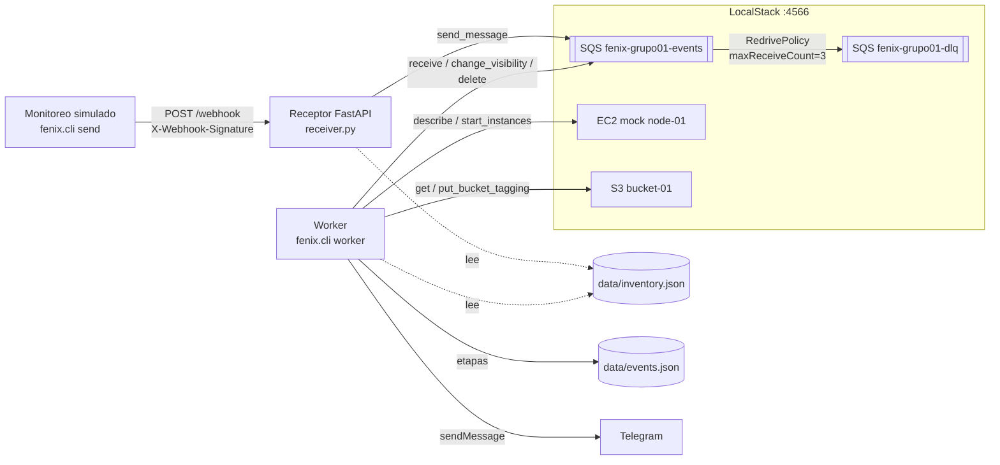
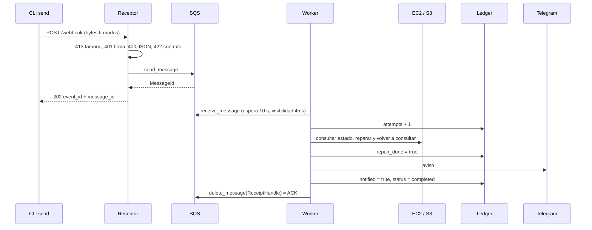

# 🔥 Proyecto Fénix — Sistema de Autorreparación de Infraestructura

**TP Final 1 — Programación para Automatización II (PPA2)** · opción 4.3.1 · grupo *pip install rezando que funcione*

**Video de defensa:** <https://www.youtube.com/watch?v=ojaDcjFT7wA> (minutos de cada integrante en la [sección 18](#18-video-de-defensa)).

Sistema de autorreparación de infraestructura cloud emulada que detecta desviaciones en recursos EC2 y S3, las corrige de forma convergente y notifica el resultado por Telegram. Toda la operación se ejecuta contra **LocalStack** (emulador local de AWS) sin credenciales ni recursos reales.

## Índice

1. [Integrantes y roles](#1-integrantes-y-roles)
2. [Arquitectura](#2-arquitectura)
3. [Prerrequisitos y versiones](#3-prerrequisitos-y-versiones)
4. [Instalación desde cero](#4-instalación-desde-cero)
5. [Variables de entorno](#5-variables-de-entorno)
6. [Ejecución](#6-ejecución)
7. [Contratos de entrada y salida](#7-contratos-de-entrada-y-salida)
8. [Reintentos y DLQ](#8-reintentos-y-dlq)
9. [Decisiones de idempotencia](#9-decisiones-de-idempotencia)
10. [Aporte de cada integrante](#10-aporte-de-cada-integrante)
11. [Pruebas](#11-pruebas)
12. [Evidencias](#12-evidencias)
13. [Canal de aviso: Telegram](#13-canal-de-aviso-telegram)
14. [Restricciones técnicas](#14-restricciones-técnicas)
15. [Estructura del proyecto](#15-estructura-del-proyecto)
16. [Limitaciones](#16-limitaciones)
17. [Limpieza del laboratorio](#17-limpieza-del-laboratorio)
18. [Video de defensa](#18-video-de-defensa)
19. [Registro de reproducción desde cero](#19-registro-de-reproducción-desde-cero)

## 1. Integrantes y roles

La consigna distribuye el trabajo en seis roles. El grupo tiene cuatro integrantes: una misma
persona cubre I3 e I5, y las tareas de I6 se reparten: cada rol prueba lo suyo, y la inyección de
fallas (I6-A) y el redrive real a la DLQ (I6-D) los hizo I5.

| Rol | Integrante | Correo | Módulos | Pruebas que defiende |
| --- | --- | --- | --- | --- |
| I1 · Entradas y excepciones | Orozco, Eliseo Jesús | eliseorozcow@gmail.com | `utils/validation.py`, `services/events.py` (`validate`, `fingerprint`), revisión de `utils/errors.py` | `test_i1_validation.py`, `test_i1_events.py`, `test_contracts.py`, `scripts/evidencia_i1.py` · F06, F07, F15 |
| I2 · Mensajería e inventario cloud | Puca Arenas, Fernanda Alejandra | pucafernanda18@gmail.com | `services/sqs.py` (`ensure_queues`, `retry_later`), `services/demo.py` (`setup_demo` y sus auxiliares) | Capturas de [`evidencias/i2/`](evidencias/i2/); su código corre en `test_integracion.py` y `test_scenarios.py::test_redrive_with_localstack` · F01, F08, F10 |
| I3 · Webhooks y reparación | Gutierrez, Ivan Gonzalo | guiru3711@gmail.com | `utils/crypto.py` (`verify`), `services/receiver.py`, `services/remediation.py` (`repair`) | `test_webhook.py`, `test_remediation.py` (clases `TestRepair*` y pruebas `localstack`), `test_fenix.py` · F02–F06, F13 |
| I4 · Observabilidad y comunicación | Miranda, Maria Natalia | natumiranda.28@gmail.com | `utils/logging_json.py`, `services/notifications.py` (Telegram) | `test_logging_f16.py`, `test_notifications.py`, `test_base.py` · F14, F16 |
| I5 · Integración y worker | Gutierrez, Ivan Gonzalo | guiru3711@gmail.com | `services/worker.py` (`run`), `services/remediation.py` (`handle`), revisión de `cli.py` | `test_worker.py`, `test_remediation.py` (pruebas `f02`–`f15`), `test_scenarios.py`, `test_integracion.py` · F08–F12, F14, F15 |
| I6 · Pruebas y diagnóstico (repartido) | Gutierrez, Ivan Gonzalo (I6-A e I6-D) | guiru3711@gmail.com | `demo.inject_fault`, `scripts/limpiar_laboratorio.py` | `test_inject_fault.py`, `test_scenarios.py::test_redrive_with_localstack` |

**Alcance de cada rol**

- **I1:** valida entradas y recursos, usa mensajes de error seguros y registra una evidencia individual sin publicar datos inválidos.
- **I2:** crea las colas con su DLQ y el laboratorio EC2/S3 de forma idempotente, y reprograma reintentos sin copiar mensajes.
- **I3:** verifica firma y antigüedad del timestamp, responde con los códigos HTTP definidos y demuestra las reparaciones mediante API.
- **I4:** produce logs JSON legibles, registra un histórico gzip y administra el canal de avisos sin ocultar errores controlados.
- **I5:** coordina receptor, cola, persistencia, reparación y ACK; también reanuda una ejecución incompleta sin repetir efectos confirmados.
- **I6 (repartido):** fabrica fallas controladas sobre recursos propios y demuestra el redrive real a la DLQ.

## 2. Arquitectura


**Flujo principal:**

1. `CLI send` firma un evento JSON con HMAC-SHA256 y lo envía vía HTTP al receptor.
2. El **receptor FastAPI** verifica la firma, valida el evento contra el inventario y lo encola en SQS (respuesta `202 Accepted`). No repara nada dentro de la petición.
3. El **worker**, en otro proceso, consume mensajes de la cola uno a uno con long polling (10 s).
4. El **handler de remediación** revalida el evento, repara el recurso (arranca EC2 o restaura tags de S3) y notifica por Telegram/consola, registrando cada etapa en un ledger durable (`data/events.json`).
5. Solo tras el éxito durable del handler se ejecuta el ACK (delete del mensaje). Ante fallas, se aplica **backoff exponencial** vía `change_message_visibility`. Tras 3 recepciones fallidas, SQS aísla el mensaje en la **DLQ**.

Los eventos solo nombran **aliases** del inventario (`node-01`, `bucket-01`), nunca IDs elegidos
por quien envía la alerta. Repetir un evento o reiniciar el worker no repite acciones ya verificadas.



Flujo nominal y ubicación del ACK:



Cada proceso (receptor, worker y cada comando de la CLI) escribe su propio log JSON en `logs/`.

## 3. Prerrequisitos y versiones

| Componente | Versión |
| --- | --- |
| Python | 3.11 o superior; todo se verificó con 3.14.5 |
| Docker + Docker Compose | Docker Desktop (Engine 29.8) para ejecutar LocalStack |
| LocalStack | `localstack/localstack:4.14.0`, edición community, `EC2_VM_MANAGER=mock` (imagen tomada de `LOCALSTACK_IMAGE` en `.env`) |
| Dependencias Python | [`requirements.txt`](requirements.txt) (boto3, fastapi, uvicorn, requests, python-dotenv, pytest, httpx); versiones exactas probadas en [`requirements-lock.txt`](requirements-lock.txt): boto3 1.44.6, FastAPI 0.165.0, uvicorn 0.54.0, requests 2.34.2, pytest 9.2.0 |

La cuenta de Telegram solo hace falta para el envío real del aviso; para desarrollar alcanza el
modo `console`.

## 4. Instalación desde cero

1. Clonar, crear el entorno virtual e instalar el proyecto en modo editable.

   Bash (Linux, macOS, WSL):

   ```bash
   git clone https://github.com/FernandaPuca1811/Proyecto_fenix.git
   cd Proyecto_fenix
   python3 -m venv .venv
   source .venv/bin/activate
   python -m pip install -r requirements-lock.txt
   python -m pip install -e .
   cp .env.example .env
   ```

   Windows PowerShell:

   ```powershell
   git clone https://github.com/FernandaPuca1811/Proyecto_fenix.git
   cd Proyecto_fenix
   py -3.14 -m venv .venv
   .venv\Scripts\Activate.ps1
   python -m pip install -r requirements-lock.txt
   python -m pip install -e .
   Copy-Item .env.example .env
   ```

2. Completar `.env` ([sección 5](#5-variables-de-entorno)). Como mínimo:
   - generar el secreto del webhook y pegarlo en `WEBHOOK_SECRET`:
     `python -c "import secrets; print(secrets.token_urlsafe(32))"`;
   - `AWS_ENDPOINT_URL=http://127.0.0.1:4566` (en Windows, `localhost` intenta primero IPv6 y
     cada conexión nueva tarda unos 2 s);
   - `LOCALSTACK_IMAGE=localstack/localstack:4.14.0` (la plantilla trae la imagen `2026.10.0`
     de la cátedra, que exige token).

3. Con Docker Desktop abierto, levantar LocalStack y esperar a que responda:

   ```bash
   docker compose up -d
   curl http://127.0.0.1:4566/_localstack/health
   ```

   En `services`, `sqs`, `s3` y `ec2` tienen que figurar como `available` o `running`. Python
   se ejecuta en el host, no dentro del contenedor.

4. Comprobar la instalación con las pruebas que no necesitan LocalStack:
   `python -m pytest -m "not integracion" -q`.

Con `pip install -e .` no hace falta `PYTHONPATH`. Todos los comandos se ejecutan desde la raíz
del proyecto con el entorno activado.

## 5. Variables de entorno

`.env` nunca se sube al repositorio (está en `.gitignore`); los valores reales del grupo se
comparten por fuera. [`.env.example`](.env.example) es la plantilla.

| Variable | Uso | Valor de laboratorio |
| --- | --- | --- |
| `AWS_ENDPOINT_URL` | Endpoint de LocalStack. `settings.client` rechaza cualquier destino que no sea `localhost`/`127.0.0.1:4566` | `http://127.0.0.1:4566` |
| `AWS_ACCESS_KEY_ID`, `AWS_SECRET_ACCESS_KEY` | Credenciales ficticias del emulador | `test` |
| `AWS_DEFAULT_REGION` | Región del laboratorio | `us-east-1` |
| `GROUP_ID` | Identificador del grupo (`[a-z0-9-]{3,32}`); nombra y etiqueta los recursos | `grupo01` |
| `QUEUE_PREFIX` | Prefijo de colas: `<prefijo>-events` y `<prefijo>-dlq` | `fenix-grupo01` |
| `PROJECT` | Informativo; el código no lo usa | `fenix` |
| `WEBHOOK_SECRET` | Secreto HMAC compartido por emisor y receptor; mínimo 16 caracteres | generado, privado |
| `NOTIFY_PROVIDER` | `console` imprime el aviso en la terminal; `telegram` lo envía al chat | `console` |
| `TELEGRAM_BOT_TOKEN`, `TELEGRAM_CHAT_ID` | Credenciales del bot y chat autorizado | privados |
| `SLACK_WEBHOOK_URL` | No se usa: el grupo eligió Telegram | vacío |
| `LOCALSTACK_IMAGE` | Imagen fija de LocalStack (nunca `latest`) | `localstack/localstack:4.14.0` |
| `LOCALSTACK_AUTH_TOKEN` | Opcional; la imagen 4.14.0 community no lo necesita | privado |

## 6. Ejecución

### Comandos de la CLI

| Comando | Qué hace |
| --- | --- |
| `python -m fenix.cli init-queues` | Crea la DLQ (`<prefijo>-dlq`, retención 14 días) y la cola principal (`<prefijo>-events`) con `RedrivePolicy` (`maxReceiveCount=3`). Idempotente: si ya existen, retorna las mismas URLs |
| `python -m fenix.cli setup-demo` | Crea o reutiliza `node-01` (Security Group + instancia EC2 `t3.micro` con `ClientToken` estable) y `bucket-01` (S3), con las etiquetas `ManagedBy=ppa2`, `Project=fenix`, `GroupId` y `Owner`. Guarda `data/inventory.json` con reemplazo atómico |
| `python -m fenix.cli fault node-01` | Detiene la instancia y comprueba `stopped` |
| `python -m fenix.cli fault bucket-01` | Quita la etiqueta `Owner` del bucket y conserva las demás |
| `python -m fenix.cli send <evento.json>` | Firma el JSON con HMAC-SHA256 (`WEBHOOK_SECRET`) y lo envía como `POST /webhook`; muestra el código HTTP |
| `python -m fenix.cli worker` | Bucle continuo: consume SQS, repara, avisa y confirma. `--once` hace una sola consulta |

### Demostración completa

Con LocalStack levantado y el entorno activado en todas las terminales:

```bash
python -m fenix.cli init-queues
python -m fenix.cli setup-demo
python -m fenix.cli fault node-01
```

**Terminal 1** — receptor (un solo proceso):

```bash
python -m uvicorn fenix.services.receiver:app --host 127.0.0.1 --port 8000 --workers 1 --env-file .env
```

**Terminal 2** — worker:

```bash
python -m fenix.cli worker
```

**Terminal 3** — enviar la alerta:

```bash
python -m fenix.cli send examples/node-event.json
# 202 {"status":"accepted","event_id":"evt-node-001","message_id":"..."}
```

Para el bucket: `python -m fenix.cli fault bucket-01` y `python -m fenix.cli send examples/bucket-event.json`.

Cada incidencia nueva necesita un `event_id` nuevo: un evento ya completado no representa una
falla nueva (F11). Para el backoff y la DLQ están [`evidencias/eventos/nodo-backoff.json`](evidencias/eventos/nodo-backoff.json)
(`simulate_failures: 2`) y [`evidencias/eventos/nodo-dlq.json`](evidencias/eventos/nodo-dlq.json)
(`5`); para repetirlos, cambiar el `event_id`.

Consultar el resultado por API (no por el log):

```bash
python -c "from fenix.config.settings import client; from fenix.utils.state import load; i=load('data/inventory.json'); print(client('ec2').describe_instances(InstanceIds=[i['node-01']['id']])['Reservations'][0]['Instances'][0]['State']['Name']); print(client('s3').get_bucket_tagging(Bucket=i['bucket-01']['id'])['TagSet'])"
```

Leer la DLQ sin borrar ni ocultar mensajes:

```bash
python -c "from fenix.config.settings import client; s=client('sqs'); u=s.get_queue_url(QueueName='fenix-grupo01-dlq')['QueueUrl']; [print(m['MessageId'], m['Body']) for m in s.receive_message(QueueUrl=u, MaxNumberOfMessages=10, WaitTimeSeconds=1, VisibilityTimeout=0).get('Messages', [])]"
```

Seguir el log del worker en tiempo real:

```powershell
Get-Content logs\fenix-worker-*.jsonl -Wait -Tail 10     # PowerShell
tail -f logs/fenix-worker-*.jsonl                        # Linux/macOS
```

`Ctrl+C` detiene receptor y worker de forma controlada; el listener del log se cierra en `finally`.

## 7. Contratos de entrada y salida

### Evento (contrato cerrado)

Dos tipos de alerta: `instance.stopped` (el nodo `node-01`, EC2 mock, quedó detenido) y
`bucket.tags_missing` (el bucket `bucket-01` perdió `Owner`). Ejemplos listos en
[`examples/node-event.json`](examples/node-event.json) y [`examples/bucket-event.json`](examples/bucket-event.json):

```json
{
  "schema_version": 1,
  "event_id": "evt-node-001",
  "event_type": "instance.stopped",
  "resource_id": "node-01",
  "occurred_at": "2026-10-22T18:00:00Z",
  "simulate_failures": 0
}
```

| Campo | Regla |
| --- | --- |
| (objeto) | Objeto JSON con exactamente estas seis claves: ni faltantes ni extra. Una lista JSON no es un evento |
| `schema_version` | El entero `1` (`True` se rechaza: se compara `type(x) is int`) |
| `event_id`, `resource_id` | `[a-z0-9-]{3,32}`, sin normalizar mayúsculas |
| `event_type` | `instance.stopped` (recurso `ec2`) o `bucket.tags_missing` (recurso `s3`) |
| `resource_id` | Alias presente en `data/inventory.json` y de tipo compatible con `event_type` |
| `occurred_at` | ISO 8601 con UTC explícito (`Z` o `+00:00`). Describe el evento; el timestamp de la firma es otro dato |
| `simulate_failures` | Entero de 0 a 5, solo para laboratorio. Con `n`, las primeras `n` ejecuciones de ese `event_id` fallan antes de reparar; la cuenta vive en disco |

### Firma HMAC

- Cabecera: `X-Webhook-Signature: t=<epoch>,v1=<64 hex>`.
- Firma: `HMAC-SHA256(WEBHOOK_SECRET, str(t) + "." + raw_body)` sobre los **bytes exactos**
  recibidos, antes de interpretar el JSON.
- Ventana de ±300 segundos respecto del reloj del receptor.
- Formato estricto: `t` y `v1` exactamente una vez cada uno; se rechazan claves extra o
  repetidas, espacios, signos, ceros a la izquierda en `t` y hex en mayúsculas.
- Comparación con `hmac.compare_digest`. La ventana no evita repeticiones dentro de los
  5 minutos: eso lo cubren el ledger y la reparación convergente.

### Respuestas del receptor (`POST /webhook`)

| Situación | Código | Cuerpo | Efecto |
| --- | --- | --- | --- |
| Cuerpo mayor a 16 KiB | `413` | `Cuerpo demasiado grande` | No publica |
| Firma ausente, malformada, incorrecta o fuera de ventana | `401` | `Firma ausente o inválida` (igual para cualquier causa) | No publica |
| JSON roto o UTF-8 inválido con firma válida | `400` | `JSON o UTF-8 inválido` | No publica |
| JSON válido pero fuera de contrato | `422` | `Evento fuera de contrato: <regla>` | No publica |
| Inventario ilegible o SQS sin confirmar | `503` | `Cola no disponible; reintentar más tarde` | No promete aceptación |
| Receptor sin `WEBHOOK_SECRET` válido | `500` | `Receptor sin configurar` (el proceso además no arranca) | No publica |
| SQS confirmó `send_message` | `202` | `{"status":"accepted","event_id":...,"message_id":...}` | El worker procesa después |

Boto3 es bloqueante: el endpoint `async` lo ejecuta con `run_in_threadpool`. La latencia hasta la
confirmación de SQS queda en el log de cada evento aceptado: en las evidencias, 323 ms el primero
(incluye crear el cliente Boto3) y entre 24 y 48 ms los siguientes.

### Inventario (`data/inventory.json`, lo escribe `setup-demo`)

```json
{
  "node-01":   {"type": "ec2", "id": "<InstanceId>", "security_group_id": "<GroupId>",
                "expected_tags": {"ManagedBy": "ppa2", "Project": "fenix", "GroupId": "grupo01", "Owner": "grupo01"}},
  "bucket-01": {"type": "s3", "id": "fenix-grupo01-demo",
                "expected_tags": {"ManagedBy": "ppa2", "Project": "fenix", "GroupId": "grupo01", "Owner": "grupo01"}}
}
```

`ManagedBy`, `Project` y `GroupId` identifican al dueño: si un recurso real tiene alguna de ellas
con otro valor, ni `repair` ni `inject_fault` lo tocan. `Owner` es la etiqueta que se repara.

### Ledger (`data/events.json`, lo escribe solo el worker)

| Campo | Significado |
| --- | --- |
| `event` / `fingerprint` | Contenido validado y su huella SHA-256 (`events.fingerprint`). El mismo `event_id` con otra huella es un conflicto |
| `attempts` | Ejecuciones de ese `event_id`; se guarda antes de simular fallas |
| `repair_done` / `repair_result` | Reparación verificada y su resultado: `repaired` o `already_ok` |
| `notified` | Aviso confirmado por el proveedor |
| `status` | `received`, `retry_pending`, `repair_failed`, `repaired`, `notify_pending` o `completed` |
| `last_error` | Tipo del último fallo, sin mensajes sensibles |
| `created_at` / `updated_at` | Marcas UTC |

### Logs JSON

Un archivo por proceso: `logs/<componente>-<pid>.jsonl`, una línea JSON por registro con
`timestamp` (UTC), `level`, `message`, `process`, `thread` y el contexto `event_id`, `message_id`,
`resource_id`, `attempt`, `action` y `status` (`null` cuando no aplica). Rotación a los 2 MiB con
tres históricos `.gz`. No se registran secretos, firmas, cuerpos HTTP ni URLs privadas.

| Nivel | Cuándo |
| --- | --- |
| `DEBUG` | Consulta sin mensajes disponibles |
| `INFO` | Evento aceptado, mensaje recibido, reparación verificada, aviso confirmado, ACK |
| `WARNING` | Fallos transitorios (falla simulada, aviso pendiente) y rechazos 401/400/413/422 |
| `ERROR` | Fallos permanentes, conflicto de `event_id`, ACK o backoff fallidos, 503 |
| `CRITICAL` | Receptor sin secreto al arrancar, ledger o inventario ilegibles |

En las líneas del worker, `attempt` es el número de recepción de ese mensaje en SQS
(`ApproximateReceiveCount`); en las de `handle` es `attempts` del ledger para ese `event_id`.

### Aviso

Texto breve sin secretos, de hasta 1000 caracteres, por ejemplo:
`Fénix: node-01 (ec2) reparado; instancia en running verificada. event_id=evt-node-001`.

## 8. Reintentos y DLQ

- **Recepción:** long polling de 10 s, un mensaje por vez y visibilidad de 45 s. Una consulta sin
  mensajes no es un error.
- **ACK:** `delete_message` con el `ReceiptHandle` de la recepción actual, solo después de que
  `handle` guardó reparación y aviso. Nunca en `finally`, nunca con el `MessageId`.
- **Backoff:** ante un fallo se cambia la visibilidad del mismo mensaje a
  `min(30, 2 ** ApproximateReceiveCount)` segundos: 2, 4 y 8. No se hace `send_message` de una
  copia, porque reiniciaría la cuenta de recepciones.
- **DLQ:** la cola de trabajo tiene `RedrivePolicy` con `maxReceiveCount=3`; en la cuarta
  recepción SQS mueve el mensaje a `<prefijo>-dlq` (retención de 14 días). El worker no borra
  mensajes venenosos ni los deriva a mano.
- **Clasificación de fallos:**

  | Tipo | Ejemplos | Tratamiento |
  | --- | --- | --- |
  | Transitorio (`RetryableError`) | Throttling, 5xx, conexión o timeout del SDK, `pending`/`stopping`, Telegram 429/5xx, falla simulada | Se conserva el mensaje y se reintenta con backoff |
  | Permanente (`PermanentError`, `ValidationError`) | JSON corrupto, evento fuera de contrato, recurso ajeno o inexistente, instancia `terminated`, conflicto de `event_id`, Telegram 4xx | Se conserva el mensaje y la misma DLQ lo aísla; cambia el nivel del log |
  | Estado local ilegible | `data/events.json` o el inventario corruptos | `CRITICAL` y el worker se detiene sin ACK: no es culpa del mensaje y mandaría mensajes sanos a la DLQ |

- **Fallos del propio transporte:** si falla `receive_message`, se registra y se espera 2 s (con
  `--once`, sale con código 1). Si falla el backoff o el ACK, el mensaje queda sin confirmar y
  vuelve al vencer la visibilidad; el handler idempotente lo absorbe.
- `NotImplementedError` nunca se silencia: muestra una plantilla incompleta.

## 9. Decisiones de idempotencia

- **Tres identificadores distintos.** `event_id` identifica la operación de negocio; `MessageId`,
  el mensaje SQS; `ReceiptHandle`, la recepción actual (es lo único que sirve para el ACK).
  Reenviar el mismo evento produce otro `MessageId` con el mismo `event_id`.
- **Ledger por etapas.** `handle` guarda `attempts`, luego `repair_done` y luego `notified`, cada
  uno antes de pasar a la etapa siguiente. Si el proceso se cae después de reparar y antes de
  avisar (F12), el reinicio encuentra `repair_done=true` y solo vuelve a avisar.
- **Reparación convergente.** `repair` consulta el estado real antes de actuar: `running` es
  `already_ok`; `stopped` lleva a `start_instances` y a verificar `running`; `pending`/`stopping`
  se reintentan; `terminated` es permanente. No se usa `reboot_instances`, porque repetir un
  reinicio vuelve a producir el efecto, mientras que `start` sobre el estado deseado no cambia
  nada. En S3 se leen las etiquetas, se mezclan con las obligatorias (`put_bucket_tagging`
  reemplaza el conjunto completo, así que las ajenas se conservan), se escriben y se releen.
- **Conflictos.** El mismo `event_id` con otro contenido (otra huella) no modifica el registro
  original ni los recursos: se registra como `conflict` y el mensaje termina en la DLQ (F15).
- **Pertenencia.** Los IDs salen del inventario, nunca del evento, y antes de actuar se comprueban
  las etiquetas de identidad (por ejemplo, después de reiniciar LocalStack con un inventario viejo).
- **Laboratorio repetible.** `init-queues` y `setup-demo` reutilizan colas y recursos por nombre y
  etiquetas, la instancia se crea con un `ClientToken` estable y el inventario se guarda de forma
  atómica; `fault` no repite una falla ya presente.
- **Límite honesto.** Un JSON local no convierte varias APIs en una transacción: no se promete
  "exactamente una vez". Si el aviso llega a Telegram pero el proceso cae antes de guardar
  `notified`, el reinicio puede repetir ese aviso.

## 10. Aporte de cada integrante

### Integrante 1: Entradas y excepciones

Es la **puerta de entrada** del sistema: decide si un evento es aceptable *antes* de publicarlo en SQS o de tocar un recurso. Todo dato externo se trata como no confiable. `events.validate` se ejecuta **dos veces**: en el receptor (un `ValidationError` se traduce en `422` y no se publica nada) y de nuevo en el worker, porque un mensaje puede llegar a SQS sin pasar por HTTP (F08). Ahí es una falla permanente: no hay ACK y la `RedrivePolicy` lo aísla en la DLQ.

| Archivo | Contenido |
| --- | --- |
| `src/fenix/utils/validation.py` | `identifier`, `ttl_seconds`, `utc_text`: validadores puros de valores sueltos |
| `src/fenix/services/events.py` | `validate` (contrato cerrado del evento) y `fingerprint` (huella SHA-256 del contenido) |
| `src/fenix/utils/errors.py` | Revisión de la jerarquía y de cuándo se usa cada excepción |
| `tests/test_i1_validation.py`, `tests/test_i1_events.py` | 182 casos (43 funciones de prueba con la parametrización), 100 % de cobertura de líneas y ramas |
| `scripts/evidencia_i1.py` | Un evento correcto y tres rechazos, sin publicación |
| [`docs/I1_entradas_y_excepciones.md`](docs/I1_entradas_y_excepciones.md) | Detalle, decisiones de diseño y preparación de la defensa |

**Contrato de cada función** (la excepción es siempre `ValidationError`):

| Función | Entra | Sale | Rechaza cuando |
| --- | --- | --- | --- |
| `identifier(value)` | cualquier valor | el mismo texto, sin normalizar | no es `str` o no cumple `[a-z0-9-]{3,32}` (`fullmatch`) |
| `ttl_seconds(value)` | texto | `int` de 60 a 600 | no son solo dígitos ASCII o está fuera de rango |
| `utc_text(value)` | texto ISO 8601 | `datetime` con zona UTC | forma ambigua, sin zona, offset distinto de cero (p. ej. `-03:00`) o fecha inexistente |
| `validate(event, inventory)` | `dict` del evento y `dict` del inventario | copia validada (solo `int` y `str`) | incumple el contrato ([reglas por campo](#evento-contrato-cerrado)) |
| `fingerprint(event)` | evento ya validado | SHA-256 hexadecimal del JSON canónico | — (`TypeError` si no es serializable) |

**Cómo funciona `validate`**, en este orden (cada compuerta rechaza un tipo de problema):

1. El evento es un `dict` (una lista JSON es JSON válido pero no un evento: `422`, no `400`) y el inventario también (falla cerrada).
2. Las claves son exactamente las seis del contrato. Se nombran las que **faltan**; de las sobrantes solo se informa **cuántas**, porque su nombre lo controla quien envía.
3. `schema_version` y `simulate_failures` son enteros exactos (`type(x) is int`: `True == 1` y `bool` hereda de `int`).
4. `event_id` y `resource_id` pasan por `identifier`, `occurred_at` por `utc_text`, y `event_type` es uno de los dos permitidos (se comprueba `str` antes del `in`: una lista no es hashable y lanzaría `TypeError`).
5. `resource_id` es un **alias** presente en el inventario. Un `InstanceId` real cumple el patrón de `identifier`, pero no es clave del inventario, así que se rechaza.
6. El tipo del evento coincide con el del recurso: `instance.stopped` con `ec2`, `bucket.tags_missing` con `s3`.
7. Devuelve `dict(event)`: una copia independiente y serializable a JSON.

<details>
<summary>Ver el código de <code>identifier</code>, <code>ttl_seconds</code> y <code>utc_text</code></summary>

```python
def identifier(value: str) -> str:
    if not isinstance(value, str):  # Un número, None o una lista no son identificadores.
        raise ValidationError("identifier debe ser texto")
    if _IDENTIFIER.fullmatch(value) is None:  # Cubre longitud, alfabeto y saltos de línea.
        raise ValidationError("identifier debe cumplir [a-z0-9-]{3,32}")
    return value  # Se devuelve el mismo texto: la identidad no cambia.

def ttl_seconds(value: str) -> int:
    if not isinstance(value, str):  # La CLI entrega texto; otro tipo es un error de uso.
        raise ValidationError("ttl debe ser un entero en texto")
    if _TTL_TEXT.fullmatch(value) is None:  # Rechaza decimales, negativos y vacío.
        raise ValidationError("ttl debe contener solo dígitos")
    try:  # La conversión sigue siendo falible: ver Notes.
        ttl = int(value)
    except ValueError as error:  # Se conserva la causa original (sin datos sensibles).
        raise ValidationError("ttl no pudo convertirse a entero") from error
    if not TTL_MIN <= ttl <= TTL_MAX:  # Ambos extremos están incluidos.
        raise ValidationError(f"ttl debe estar entre {TTL_MIN} y {TTL_MAX} segundos")
    return ttl

def utc_text(value: str) -> datetime:
    if not isinstance(value, str):  # fromisoformat lanzaría TypeError con otro tipo.
        raise ValidationError("occurred_at debe ser texto")
    match = _ISO_UTC.fullmatch(value)  # Fija la forma antes de interpretarla.
    if match is None:
        raise ValidationError("fecha con formato ISO 8601 inválido")
    if match.group("zone") is None:  # Sin Z ni offset: no hay forma segura de comparar.
        raise ValidationError("la fecha debe indicar zona UTC explícita")
    text = value[:-1] + "+00:00" if value.endswith("Z") else value  # Z -> +00:00.
    try:  # El patrón no valida el calendario: el mes 13 o el día 31 de abril llegan aquí.
        parsed = datetime.fromisoformat(text)
    except ValueError as error:
        raise ValidationError("fecha inexistente o fuera de rango") from error
    if parsed.utcoffset() != timedelta(0):  # Ej. -03:00: válida, pero no es UTC.
        raise ValidationError("la fecha debe estar en UTC (offset +00:00)")
    return parsed.astimezone(timezone.utc)  # Normaliza al objeto timezone.utc.
```

</details>

<details>
<summary>Ver el código de <code>validate</code> y <code>fingerprint</code></summary>

```python
def _strict_int(field: str, value, low: int, high: int) -> int:
    if type(value) is not int:  # Rechaza True/False, 1.0, "1" y None.
        raise ValidationError(f"{field} debe ser un entero (no bool ni decimal)")
    if not low <= value <= high:
        raise ValidationError(f"{field} debe estar entre {low} y {high}")
    return value

def validate(event: dict, inventory: dict) -> dict:
    if not isinstance(event, dict):  # Una lista, texto o null JSON son JSON válido, no un evento.
        raise ValidationError("El evento debe ser un objeto JSON")
    if not isinstance(inventory, dict):  # Falla cerrada: sin inventario no se autoriza nada.
        raise ValidationError("Inventario no disponible o con formato inválido")

    keys = set(event)  # Contrato cerrado: se comparan los conjuntos de claves.
    missing = EVENT_FIELDS - keys
    if missing:
        raise ValidationError("Faltan campos: " + ", ".join(sorted(missing)))
    extra = keys - EVENT_FIELDS
    if extra:  # Solo se informa la cantidad: los nombres los controla el remitente.
        raise ValidationError(f"Campos no permitidos en el evento: {len(extra)}")

    version = event["schema_version"]
    if type(version) is not int or version != SCHEMA_VERSION:  # type(): excluye True.
        raise ValidationError(f"schema_version debe ser el entero {SCHEMA_VERSION}")
    _check("event_id", identifier, event["event_id"])
    event_type = event["event_type"]
    # isinstance antes del "in": una lista o dict como clave lanzaría TypeError (no hashable).
    if not isinstance(event_type, str) or event_type not in EVENT_RESOURCE_TYPES:
        raise ValidationError("event_type no admitido")
    resource_id = _check("resource_id", identifier, event["resource_id"])
    _check("occurred_at", utc_text, event["occurred_at"])
    _strict_int("simulate_failures", event["simulate_failures"], 0, MAX_SIMULATED_FAILURES)

    resource = inventory.get(resource_id)  # Solo aliases presentes en el inventario.
    if not isinstance(resource, dict):
        raise ValidationError("resource_id no pertenece al inventario autorizado")
    if resource.get("type") != EVENT_RESOURCE_TYPES[event_type]:  # ec2 <-> stopped, s3 <-> tags.
        raise ValidationError("event_type incompatible con el tipo del recurso")
    return dict(event)  # Copia superficial: todos los valores validados son int o str.

def fingerprint(event: dict) -> str:
    canonical = json.dumps(event, sort_keys=True, separators=(",", ":"), ensure_ascii=True)
    return hashlib.sha256(canonical.encode("ascii")).hexdigest()  # ASCII: ensure_ascii=True.
```

</details>

**Decisiones de diseño**

| Decisión | Por qué |
| --- | --- |
| `fullmatch`, no `match` | Con `match` y `$`, `"abc\n"` pasaría: `$` acepta un salto de línea final |
| No normalizar identificadores | `AJENO` y `ajeno` serían la misma identidad; se rechaza en lugar de adivinar |
| Regex de dígitos antes de `int()` | `int()` acepta `" 60 "`, `"+60"`, `"6_0"` y dígitos árabes. El `try/except` se mantiene: Python limita la conversión a 4300 dígitos y lanza `ValueError` |
| Forma ISO fijada antes de `fromisoformat` | `fromisoformat` tolera variantes ambiguas (espacio en lugar de `T`, formato básico); un offset como `-03:00` es válido pero no UTC |
| Mensajes sin copiar la entrada | Valores y nombres de claves los controla quien envía: podrían filtrar secretos o falsear líneas de log |
| Función pura y una única excepción pública | `validate` no escribe en `data/`; un `ValueError` suelto lo tomaría el worker como estado local roto y se detendría |

**Garantías para el receptor y el worker:**

- La copia devuelta es serializable a JSON (`occurred_at` sigue siendo texto) y se publica y guarda en el ledger sin transformarla.
- Ante cualquier entrada inválida solo sale `ValidationError`.
- Los mensajes describen la regla y no reproducen la entrada (el receptor los devuelve en el `422`).
- `validate` no toca el disco. El conflicto de un mismo `event_id` con otro contenido (F15) lo detecta el worker comparando la huella de `fingerprint` guardada en el ledger.

```bash
python -m pytest -m i1 -q          # 182 casos, sin LocalStack
python scripts/evidencia_i1.py     # un evento correcto y tres rechazos; 1 publicación simulada
```

Verificado en Python 3.11, 3.12 y 3.14, con 100 % de cobertura de líneas y ramas y una prueba de
mutación manual: se rompieron a propósito reglas del código y las pruebas detectaron todas (la
cobertura mide qué líneas se ejecutan; la mutación comprueba que las pruebas verifican algo).
`scripts/evidencia_i1.py` usa un publicador simulado que solo cuenta llamadas: demuestra que un
evento rechazado nunca llega a la publicación. La prueba contra el receptor real (`422` y la cola
sin mensajes nuevos) está en `tests/test_webhook.py`.

### Integrante 2: Mensajería SQS e inventario cloud

El módulo `fenix.services.sqs` gestiona las colas estándar SQS contra LocalStack: `ensure_queues` crea la DLQ con retención de 14 días, la cola principal con `VisibilityTimeout=45` y retención de 4 días, y vincula la `RedrivePolicy` (`maxReceiveCount=3`) mediante `set_queue_attributes` para garantizar idempotencia. `retry_later` aplica backoff exponencial (`min(30, 2^count)`) exclusivamente con `change_message_visibility` sobre el `ReceiptHandle` vigente, sin re-publicar el mensaje.

El módulo `fenix.services.demo` provisiona la infraestructura mock: descubre VPC e imagen del emulador, crea o reutiliza Security Group, instancia EC2 (con `ClientToken` estable) y bucket S3, aplica las cuatro etiquetas obligatorias (`ManagedBy=ppa2`, `Project=fenix`, `GroupId`, `Owner`) y persiste atómicamente el inventario en `data/inventory.json`. Tres funciones auxiliares privadas (`_find_instance_by_tags`, `_find_sg_by_name`, `_bucket_exists`) garantizan idempotencia sin duplicar recursos.

Evidencias propias en [`evidencias/i2/`](evidencias/i2/): idempotencia de `init-queues` y
`setup-demo` (F01), backoff de 2/4/8 s en el log del worker y lectura de la DLQ (F10). Detalle
en la [matriz de pruebas](#matriz-f01f16).

### Integrante 3: Webhooks y reparación

- **`crypto.verify`:** parsea la cabecera sin confiar en ella (`t` y `v1` una vez, formato
  estricto), aplica la ventana de ±300 s y compara con `hmac.compare_digest` sobre los bytes
  exactos recibidos ([firma](#firma-hmac)).
- **Receptor:** controles en orden fijo (tamaño → firma → JSON → contrato → cola) y una respuesta
  por situación ([tabla de respuestas](#respuestas-del-receptor-post-webhook)); Boto3 corre en
  `run_in_threadpool`; sin `WEBHOOK_SECRET` válido el proceso no arranca (`CRITICAL`).
- **`repair`:** reparación convergente de EC2 (`start`, nunca `reboot`) y de S3 (mezcla, escritura
  y relectura de etiquetas), con verificación de pertenencia y clasificación de los errores del
  SDK en transitorios y permanentes ([idempotencia](#9-decisiones-de-idempotencia)).

### Integrante 4: Observabilidad y comunicación

El módulo `fenix.utils.logging_json` configura un logger JSON asíncrono para cada proceso. Escribe archivos JSONL en `logs/`, incluye marca de tiempo UTC y campos de contexto permitidos, y rota los archivos al alcanzar 2 MiB. Conserva hasta tres históricos comprimidos en gzip. La cola en memoria desacopla la escritura en disco; no reemplaza a SQS.

La CLI inicializa un logger por comando y detiene su listener al salir. Para probar la rotación y comprobar que el histórico gzip contiene líneas JSON válidas:

```bash
python -m pytest tests/test_logging_f16.py -q
```

El adaptador de Telegram trata timeout, conexión, HTTP 429 y 5xx como transitorios.
Si la respuesta incluye `Retry-After`, espera ese tiempo hasta un máximo de 30 segundos;
después propaga el error para que el worker/SQS administre el siguiente intento. Un
`Retry-After` inválido se ignora y el error transitorio se conserva. Configuración y evidencia
del canal en la [sección 13](#13-canal-de-aviso-telegram).

### Integrante 5: Integración y worker

- **`worker.run`:** long polling de un mensaje por vez; parseo del Body, `handler` y recién
  después el ACK. Un fallo programa el reintento con `retry_later`; un fallo de transporte espera
  2 s; un ledger o inventario ilegible detiene el worker sin ACK (`CRITICAL`).
- **`remediation.handle`:** vuelve a validar, compara la huella para detectar conflictos, guarda
  `attempts` antes de simular fallas y avanza por etapas durables (`repair_done`, luego
  `notified`), de modo que una reanudación no repite la reparación ([idempotencia](#9-decisiones-de-idempotencia)).
- **Revisión de la CLI** y **demostración integral** de punta a punta: caso nominal, duplicado,
  backoff, DLQ, caída entre reparación y aviso, y reanudación.

### Integrante 6: Pruebas y diagnóstico (repartido)

- **I6-A, `inject_fault`:** solo acepta aliases del inventario, verifica las etiquetas de
  identidad, detiene el nodo y comprueba `stopped` con un máximo de 15 consultas, y en el bucket
  quita solo `Owner`. Es idempotente: si la falla ya está presente, no repite la acción.
- **I6-D, `test_redrive_with_localstack`:** publica JSON corrupto en una cola con `RedrivePolicy`
  real, consume con el worker y busca el mismo Body en la DLQ con un plazo total de 120 s; imprime
  `MessageId`, Body y recepciones como evidencia (`pytest -rP`).
- **`scripts/limpiar_laboratorio.py`:** borra solo los recursos inventariados
  ([sección 17](#17-limpieza-del-laboratorio)).

## 11. Pruebas

```bash
python -m pytest -m base -q              # apoyo entregado por la cátedra (sin LocalStack)
python -m pytest -m pendiente -q         # contratos completados por el equipo
python -m pytest -m i1 -q                # integrante 1
python -m pytest -m "not integracion" -q # todo lo que no necesita LocalStack
python -m pytest -m integracion -q       # requieren LocalStack corriendo
python -m pytest -v                      # todas
```

Ejecución registrada el **2026-11-21 00:44 UTC** con Python 3.14.5 y LocalStack 4.14.0:
**321 pruebas, 321 OK** ([`evidencias/pytest_resultados.txt`](evidencias/pytest_resultados.txt)).
Las de integración crean colas y recursos con un prefijo y un grupo exclusivos y borran solo lo
que crearon. Los datos de entrada son los de `examples/` y `evidencias/eventos/`, sin datos
personales.

### Matriz F01–F16

| ID | Caso | Esperado | Obtenido | Prueba o evidencia | Resp. |
| --- | --- | --- | --- | --- | --- |
| F01 | `init-queues` y `setup-demo` dos veces | Mismas colas y recursos, sin duplicados | Mismas URLs de cola, mismo `InstanceId`, SG y bucket; inventario idéntico; 1 instancia, 1 SG y 1 bucket del grupo | [Captura F01](evidencias/i2/f01_idempotencia_init_setup.png); repetido por CLI el 2026-11-20; `test_integracion.py` usa `ensure_queues` y `setup_demo` reales | I2 |
| F02 | Nodo detenido y evento firmado válido | `running` verificado, ledger completo, aviso y ACK | `202`; `running` por Boto3; `status=completed`; ACK en el log | `test_integracion.py::test_f02_…`, `test_remediation.py::test_f02_…`, `test_remediation.py::test_localstack_stopped_node_is_running_again`; `evidencias/log_nominal.jsonl`, `boto3_estado_final.json` | I3 · I5 |
| F03 | Bucket sin `Owner` y con una etiqueta ajena | Etiquetas restauradas, ajenas preservadas | `Owner=grupo01` y `CostCenter=lab-42` por Boto3 | `test_integracion.py::test_f03_…`, `test_remediation.py::test_localstack_bucket_tags_restored_preserving_foreign`, `TestRepairBucket`; `boto3_estado_final.json` | I3 |
| F04 | Firma ausente, alterada y de hace una hora | `401` y ningún mensaje nuevo | `401` en los tres casos; nada publicado | `test_webhook.py::test_f04_*` (3), `TestVerify` | I3 |
| F05 | Mismos datos JSON con otros bytes después de firmar | `401` por HMAC inválida | `401`; nada publicado | `test_webhook.py::test_f05_same_json_different_bytes_is_401` | I3 |
| F06 | JSON roto firmado; lista JSON firmada | `400` y `422`, sin publicar | `400` (JSON roto, UTF-8 inválido, UTF-16) y `422` (lista) | `test_webhook.py::test_f06_*`, `test_i1_events.py::test_rejects_json_values_that_are_not_objects` | I3 · I1 |
| F07 | Alias ajeno y claves extra | Rechazo de esquema, ningún cambio cloud | `422` (alias ajeno, InstanceId en lugar de alias, clave extra, `bool` como entero); el worker tampoco actúa | `test_webhook.py::test_f07_…`, `test_i1_events.py::test_rejects_resource_not_in_inventory`, `test_rejects_extra_key`, `test_remediation.py::test_injected_invalid_event_has_no_effects`; `scripts/evidencia_i1.py` | I1 |
| F08 | Evento directo a SQS con JSON corrupto | El worker sigue; el mensaje termina en la DLQ | 3 recepciones con `ValidationError`, worker vivo, Body intacto en la DLQ | `test_integracion.py::test_f08_…`, `test_worker.py::test_poison_message_does_not_stop_worker`, `test_scenarios.py::test_redrive_with_localstack`; `dlq_mensajes.json`, `log_fallos.jsonl` | I5 · I2 |
| F09 | `simulate_failures=2`, ID nuevo | Backoff de 2 y 4 s; después reparación y ACK | Demoras de 2 s y 4 s; `attempts=3`; reparado y confirmado | `test_integracion.py::test_f09_…`, `test_remediation.py::test_f09_…`; `log_fallos.jsonl` (`evt-backoff-0043`) | I5 |
| F10 | Falla persistente (`simulate_failures=5`), ID nuevo | Sin ACK; derivación automática a la DLQ | Backoff de 2, 4 y 8 s, sin ACK; el payload original queda íntegro en la DLQ; ledger `attempts=3`, `repair_done=false` | `test_integracion.py::test_f10_…`; [captura del backoff](evidencias/i2/f10_worker_reintentos_backoff.png) y [lectura de la DLQ](evidencias/i2/f10_lectura_dlq.png); `dlq_mensajes.json`, `ledger_extracto.json` (`evt-dlq-0043`) | I5 · I2 |
| F11 | Repetir un evento completo; reiniciar el worker | Sin nueva reparación ni nuevo aviso | Otro `MessageId`, mismo `event_id`; un nodo detenido a propósito sigue `stopped`; `attempts=2` | `test_integracion.py::test_f11_…`, `test_remediation.py::test_f11_…`, `test_scenarios.py::test_duplicate_is_idempotent` | I5 |
| F12 | Corte después de `repair_done` y antes de avisar | El reinicio recupera solo el aviso pendiente | Tras la caída: `repair_done=true`, `notified=false`; al reiniciar: 1 reparación y 1 aviso en total | `test_remediation.py::test_f12_crash_between_repair_and_notice_resumes_only_notice` | I5 |
| F13 | SQS no disponible al recibir el webhook | `503`, sin aceptación falsa | `503` con cola inexistente (real) y con `EndpointConnectionError` | `test_integracion.py::test_f13_…`, `test_webhook.py::test_f13_sqs_unavailable_is_503` | I3 |
| F14 | Aviso con 429/timeout y luego éxito | La reparación no se repite; el aviso pendiente se reintenta | `status=notify_pending`; 1 sola reparación; un único aviso confirmado al reintentar | `test_remediation.py::test_f14_notice_429_then_success_without_new_repair`, `test_notifications.py` (429, 5xx, transporte, `Retry-After`) | I5 · I4 |
| F15 | Otro contenido con el mismo `event_id` | Conflicto; no altera el ledger ni los recursos | `PermanentError`; registro original sin cambios; mensaje en la DLQ | `test_remediation.py::test_f15_same_event_id_with_other_content_is_conflict`, `test_i1_events.py::test_fingerprint_changes_with_any_field`; `dlq_mensajes.json`, `ledger_extracto.json` | I5 · I1 |
| F16 | Forzar rotación, abrir `.gz` y parsear cada línea | JSON válido, UTC, contexto, ningún secreto | Histórico `.gz` con líneas JSON válidas, UTC y sin el token de prueba; `test_logging_f16`, `test_notifications` y `test_base`: 26 OK (I4, 2026-11-20) | `test_logging_f16.py::test_rotated_log_is_valid_gzip_jsonl`, `test_webhook.py::test_logs_are_json_without_secrets` | I4 |

Además de la matriz: verificación HMAC estricta (`TestVerify`), clasificación de errores del SDK
(`TestRepairInstance`), máquina de estados de EC2, receptor que no arranca sin secreto, ACK
fallido, backoff fallido, ledger corrupto, `inject_fault` (8 funciones de prueba, 12 casos) y las
43 funciones de prueba de I1 (182 casos con la parametrización).

## 12. Evidencias

Todo está en [`evidencias/`](evidencias/), sin secretos ni datos personales. La corrida integral
se generó el 2026-11-21 (UTC) con receptor y worker en procesos separados y avisos en modo `console`.

| Archivo | Contenido |
| --- | --- |
| `pytest_resultados.txt` | Ejecución completa (321 OK) y la evidencia de I6-D: el mismo `MessageId` en la DLQ con el Body original |
| `e2e_consola.txt` | Comandos de la CLI y sus respuestas (`init-queues`, `setup-demo`, `fault`, `send`, códigos `202`) |
| `eventos/` | Eventos enviados en esa corrida (nominal, bucket, backoff, DLQ y conflicto) |
| `log_nominal.jsonl` | Log JSON correlacionado: receptor (`accepted`) → worker (`received`, `repaired`, `notified`, `acknowledged`) del nodo y del bucket |
| `log_fallos.jsonl` | Fallas simuladas con backoff de 2/4/8 s, conflicto de `event_id` y JSON corrupto |
| `dlq_mensajes.json` | Mensajes reales leídos de la DLQ sin borrarlos (F08, F10, F15). `ApproximateReceiveCount` incluye las lecturas de verificación: es aproximado y no basta como única evidencia |
| `ledger_extracto.json` | Ledger: nominales completos, backoff con `attempts=3` y el de la DLQ sin reparar |
| `boto3_estado_final.json` | Estado final por Boto3: nodo `running`, etiquetas del bucket y cola de trabajo vacía con su `RedrivePolicy` |
| `i2/` | Capturas de I2: idempotencia de `init-queues`/`setup-demo` (F01), backoff en el log del worker y lectura de la DLQ (F10) |
| `i4/telegram_aviso_node01.png` | Captura del aviso real que el bot del grupo envió al chat después de restaurar `node-01` a `running` (2026-11-12) |
| `i4/ledger_avisos_telegram.json` | Ledger de la prueba real con Telegram: tres eventos del bucket `completed` y `notified=true` (2026-11-20) |

Evidencias que pide la consigna, por rol:

- **I1:** un evento correcto y tres rechazos sin publicación (`scripts/evidencia_i1.py`) y el `422` real del receptor (F07).
- **I2:** `init-queues` y `setup-demo` repetidos sin duplicados (F01) y lectura de mensajes reales de la DLQ (`i2/`, `dlq_mensajes.json`).
- **I3:** `401` ante firma inválida (F04/F05) y las dos reparaciones verificadas por API (F02/F03).
- **I4:** líneas JSON correlacionadas (`log_nominal.jsonl`), histórico gzip (F16) y aviso real por Telegram (`i4/`).
- **I5:** corte entre reparación y aviso y reanudación sin nueva reparación (F12), y la demostración integral del video.

## 13. Canal de aviso: Telegram

1. Crear el bot con **BotFather** y guardar el token en `TELEGRAM_BOT_TOKEN`.
2. Escribirle al bot (o agregarlo al grupo) y obtener el `chat_id` autorizado en `TELEGRAM_CHAT_ID`.
3. Poner `NOTIFY_PROVIDER=telegram`.

`notify` hace `POST https://api.telegram.org/bot<token>/sendMessage` con JSON `chat_id`/`text`
(máximo 1000 caracteres, sin `parse_mode`) y timeouts de 2 s de conexión y 5 s de lectura. Exige
HTTP 2xx y `ok=true`. 429 y 5xx son transitorios (respeta `Retry-After` hasta 30 s); los demás
4xx son permanentes. Las excepciones de `requests` se traducen sin copiar su mensaje, porque pueden
incluir la URL con el token. Mientras no existan `TELEGRAM_BOT_TOKEN` y `TELEGRAM_CHAT_ID`, el
proveedor queda en `console`.

Evidencia: [captura del aviso real](evidencias/i4/telegram_aviso_node01.png) y
[ledger de la prueba con Telegram](evidencias/i4/ledger_avisos_telegram.json). Si Telegram no
está disponible durante la defensa, se muestra esta evidencia y el adaptador con el mock de
`test_notifications.py`.

## 14. Restricciones técnicas

| Restricción | Implementación |
| --- | --- |
| Sin `except: pass` ni `BaseException` | Solo capturas específicas de `ClientError`, `BotoCoreError`, `ProjectError` y subclases |
| Sin `return`/`break`/`continue` en `finally` | Verificado en todos los módulos |
| Endpoint exclusivo `localhost:4566` | Validado en `config/settings.py` con `urlparse` |
| Sin credenciales reales de AWS | Variables ficticias (`test`/`test`) para LocalStack |
| Type hints en parámetros y retornos | Todas las funciones públicas anotadas |
| Docstrings con Args/Returns/Raises/Side Effects | Formato consistente en todo el proyecto |
| Persistencia atómica | `state.save` usa `os.replace` en el mismo filesystem |
| Nunca `send_message` en `retry_later` | Solo `change_message_visibility` para no reiniciar `ApproximateReceiveCount` |
| ACK solo tras éxito durable | `acknowledge` se llama únicamente después de que el handler persista todas las etapas |

## 15. Estructura del proyecto

```
Proyecto_fenix/
├── compose.yaml                    # LocalStack (imagen fija, EC2 mock)
├── pyproject.toml                  # Paquete y marcadores de pytest
├── requirements.txt                # Dependencias
├── requirements-lock.txt           # Versiones exactas probadas
├── .env.example                    # Plantilla de variables (.env no se versiona)
├── architecture.png                # Arquitectura entregada por la cátedra
├── examples/
│   ├── node-event.json             # Evento nominal: instancia detenida
│   └── bucket-event.json           # Evento nominal: etiqueta Owner faltante
├── src/fenix/
│   ├── cli.py                      # init-queues, setup-demo, fault, send, worker
│   ├── config/settings.py          # Clientes Boto3 forzados a localhost:4566
│   ├── services/
│   │   ├── cloud_support.py        # Recetas Boto3 (apoyo entregado)
│   │   ├── demo.py                 # setup_demo (I2) e inject_fault (I6)
│   │   ├── events.py               # validate y fingerprint (I1)
│   │   ├── notifications.py        # Telegram / console (I4)
│   │   ├── receiver.py             # Receptor FastAPI /webhook (I3)
│   │   ├── remediation.py          # repair (I3) y handle (I5)
│   │   ├── sqs.py                  # Colas, publicación, recepción, ACK y backoff (I2)
│   │   └── worker.py               # Ciclo de consumo (I5)
│   └── utils/
│       ├── crypto.py               # HMAC-SHA256 (I3)
│       ├── errors.py               # Jerarquía de excepciones (I1)
│       ├── logging_json.py         # Log JSON asíncrono con rotación gzip (I4)
│       ├── state.py                # Persistencia atómica (apoyo entregado)
│       └── validation.py           # Validadores puros (I1)
├── tests/                          # Una suite por rol (ver sección 1) y escenarios integrados
├── scripts/
│   ├── evidencia_i1.py             # Evidencia individual de I1
│   └── limpiar_laboratorio.py      # Limpieza de los recursos inventariados
├── docs/I1_entradas_y_excepciones.md
├── evidencias/                     # Corrida integral, i2/ e i4/
├── data/                           # (no versionado) inventario y ledger de ejecución
└── logs/                           # (no versionado) logs JSONL por proceso
```

## 16. Limitaciones

- Una instancia EC2 mock tiene ID, estado y etiquetas, pero no es una máquina real: se evalúa la
  automatización por API, no software dentro de una VM.
- LocalStack no persiste estado: si se reinicia, los recursos desaparecen y `data/inventory.json`
  queda viejo. Hay que volver a ejecutar `init-queues` y `setup-demo` (las etiquetas de identidad
  evitan reparar un recurso que no corresponde).
- Un solo worker y un solo proceso modifican `data/`: no hay bloqueo entre procesos. Detener el
  worker antes de usar otra CLI que toque el inventario.
- No hay "exactamente una vez": un timeout al avisar o una caída antes de guardar `notified` puede
  repetir un aviso.
- La espera por `Retry-After` (hasta 30 s) ocurre dentro de la visibilidad de 45 s del mensaje;
  sumada a una reparación lenta podría vencerla y producir una recepción duplicada, que el ledger
  absorbe.
- `pending` después de `start_instances` se resuelve en otra recepción: si se confirma `running`
  recién ahí, el ledger registra `already_ok` aunque la orden la haya dado Fénix.
- El movimiento a la DLQ depende de una nueva recepción y sus contadores son aproximados: no es un
  cronómetro exacto.
- El receptor lee el cuerpo completo antes de rechazar por tamaño; en producción lo limitaría un
  proxy.
- En Windows, `localhost` agrega unos 2 s por conexión (intento IPv6); por eso se usa `127.0.0.1`.

## 17. Limpieza del laboratorio

1. Detener receptor y worker (`Ctrl+C`).
2. Documentar la DLQ antes de borrarla ([sección 6](#demostración-completa)).
3. Borrar únicamente los recursos inventariados:

   ```bash
   python scripts/limpiar_laboratorio.py            # termina la instancia, vacía y borra el bucket, elimina el SG
   python scripts/limpiar_laboratorio.py --colas    # además borra la cola de trabajo y la DLQ
   ```

4. Recién entonces borrar `data/` y apagar LocalStack: `docker compose down`.

`data/` y `logs/` son de ejecución y no se versionan.

## 18. Video de defensa

Video grupal (54:10): <https://www.youtube.com/watch?v=ojaDcjFT7wA>. Cada inicio abre el video en
ese minuto.

| Rol | Integrante | Inicio | Fin |
| --- | --- | --- | --- |
| I1 · Entradas y excepciones | Orozco, Eliseo Jesús | [00:00](https://www.youtube.com/watch?v=ojaDcjFT7wA&t=0s) | 08:55 |
| I2 · Mensajería e inventario | Puca Arenas, Fernanda Alejandra | [08:56](https://www.youtube.com/watch?v=ojaDcjFT7wA&t=536s) | 21:54 |
| I3 · Webhooks y reparación | Gutierrez, Ivan Gonzalo | [21:55](https://www.youtube.com/watch?v=ojaDcjFT7wA&t=1315s) | 33:00 |
| I4 · Observabilidad y comunicación | Miranda, Maria Natalia | [33:01](https://www.youtube.com/watch?v=ojaDcjFT7wA&t=1981s) | 43:29 |
| I5 · Integración y worker, con I6-A, I6-D y la demostración integral | Gutierrez, Ivan Gonzalo | [43:30](https://www.youtube.com/watch?v=ojaDcjFT7wA&t=2610s) | 54:10 |

## 19. Registro de reproducción desde cero

Otro integrante clona el repositorio en una carpeta nueva, crea su entorno y su `.env` y sigue
solamente este README.

| Fecha | Integrante | Sistema | Resultado e instrucciones corregidas |
| --- | --- | --- | --- |
| 2026-11-20 | Gutierrez, Ivan Gonzalo | Windows 11, Python 3.14.5, Docker Desktop con LocalStack 4.14.0 | `pytest -m "not integracion"` 310 OK; `pytest` completo 321 OK; `init-queues`, `setup-demo`, `fault node-01`, receptor y worker en procesos separados y `send` → `202`, ledger `completed` y nodo `running` por Boto3. Correcciones incorporadas a la sección 4: carpeta `Proyecto_fenix`, `127.0.0.1` y la imagen `4.14.0` en `.env` |
